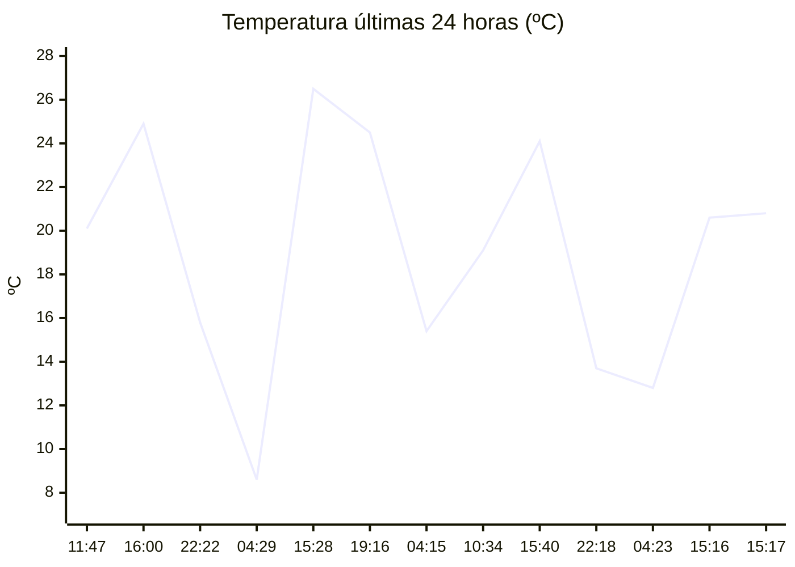

# rem-scrap

Actualización automática del clima para la estación Concarán.

## Últimos datos

| Campo | Valor |
| --- | --- |
| Estación | Concarán |
| Hora | 15:16 |
| Temperatura | 20,8 ºC |
| Humedad | 54,3 % |
| Lluvia (1h) | 0,0 mm |
| Lluvia (24h) | 0,0 mm |
| Lluvia (30d) | 40,6 mm |
| Lluvia (Año) | 552,6 mm |
| Rad. Solar | 669,0 W/m2 |
| Temp Max Hoy | 21 ºC a las 12:50 |
| Temp Min Hoy | 12 ºC a las 06:21 |
| VPS (VPD) | 1.12 kPa (ideal) |

## Resumen IA

Estación Concarán, 15:16, tarde templada y soleada.  
Temperatura actual 20,8 ºC, muy cercana al máximo del día (21 ºC a las 12:50) y distante del mínimo (12 ºC a las 06:21); el rango térmico del día es de 9 ºC y la temperatura actual se sitúa en el extremo superior.  
Humedad relativa 54,3 % y VPD 1,12 kPa, valor catalogado como ideal: indica una demanda de vapor moderada, buena transpiración y bajo riesgo de desarrollo de hongos.  
No se registró lluvia en la última hora ni en las últimas 24 h; el acumulado mensual es 40,6 mm y el anual 552,6 mm. La radiación solar de 669,0 W/m² a esta hora muestra una intensidad solar alta, típica de la mitad de la tarde.  
Recomendación: mantener riego moderado, asegurar buena ventilación y usar sombra parcial si el cultivo es sensible al fuerte sol.

## Tendencia últimas 24 h

## Fuente

Datos extraídos de [clima.sanluis.gob.ar](https://clima.sanluis.gob.ar/Estacion.aspx?estacion=8).

## Generado automáticamente

Este archivo fue actualizado el 23 de octubre de 2026 a las 06:17:51.
