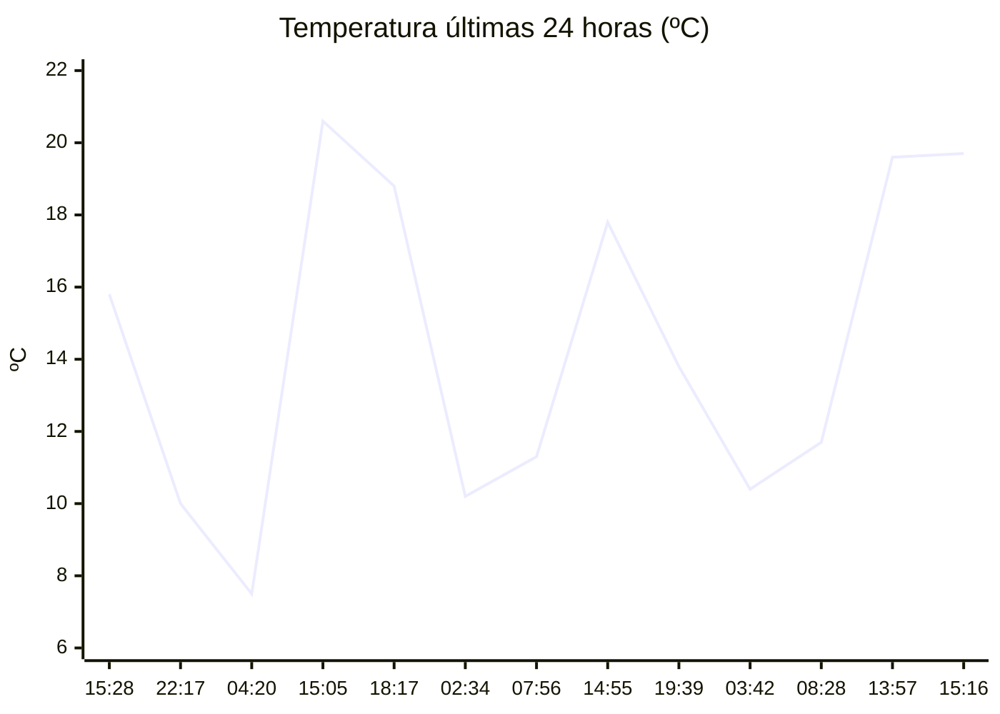

# rem-scrap

Actualización automática del clima para la estación Concarán.

## Últimos datos

| Campo | Valor |
| --- | --- |
| Estación | Concarán |
| Hora | 15:15 |
| Temperatura | 19,7 ºC |
| Humedad | 43,1 % |
| Lluvia (1h) | 0,0 mm |
| Lluvia (24h) | 2,7 mm |
| Lluvia (30d) | 36,0 mm |
| Lluvia (Año) | 548,1 mm |
| Rad. Solar | 143,0 W/m2 |
| Temp Max Hoy | 22 ºC a las 14:39 |
| Temp Min Hoy | 9 ºC a las 05:44 |
| VPS (VPD) | 1.31 kPa (alto) |

## Resumen IA

Estación Concarán, 15:15 h – se presenta una tarde templada y algo seca.  

Temperatura: la lectura actual es 19,7 ºC, dentro de un rango térmico de 13 ºC (máx 22 ºC – min 9 ºC). La temperatura del momento está a 2,3 ºC de la máxima y a 10,7 ºC de la mínima, por lo que se aproxima más al extremo caluroso del día.  

Humedad y vapor: la humedad relativa es 43,1 %, y el VPD indica 1,31 kPa, un valor “alto”. Se encuentra por encima del rango ideal (0,8‑1,2 kPa) y señala un aire algo seco, con riesgo moderado de estrés hídrico para cultivos que demandan alta transpiración; la humedad moderada no compensa esa demanda.  

Lluvia y radiación: no hubo precipitación en la última hora, pero en las últimas 24 h cayó 2,7 mm, lo que eleva ligeramente la humedad del suelo. La radiación solar de 143 W/m2 a media tarde indica una intensidad solar moderada, todavía suficiente para fotosíntesis pero sin picos de radiación.  

Recomendación: aumente la irrigación o utilice riego por goteo para evitar estrés hídrico y mantenga una ligera ventilación para reducir la demanda evaporativa.

## Tendencia últimas 24 h

## Fuente

Datos extraídos de [clima.sanluis.gob.ar](https://clima.sanluis.gob.ar/Estacion.aspx?estacion=8).

## Generado automáticamente

Este archivo fue actualizado el 17 de octubre de 2026 a las 06:16:06.
