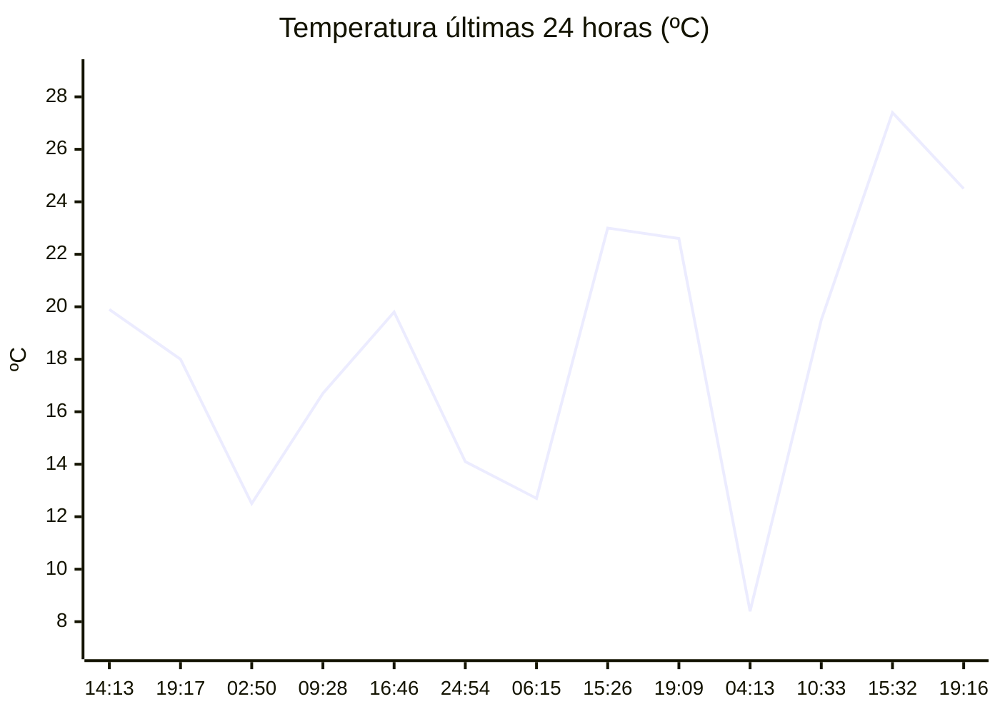

# rem-scrap

Actualización automática del clima para la estación Concarán.

## Últimos datos

| Campo | Valor |
| --- | --- |
| Estación | Concarán |
| Hora | 19:15 |
| Temperatura | 24,5 ºC |
| Humedad | 34,3 % |
| Lluvia (1h) | 0,0 mm |
| Lluvia (24h) | 0,0 mm |
| Lluvia (30d) | 36,0 mm |
| Lluvia (Año) | 548,1 mm |
| Rad. Solar | 11,0 W/m2 |
| Temp Max Hoy | 29 ºC a las 16:37 |
| Temp Min Hoy | 7 ºC a las 06:36 |
| VPS (VPD) | 2.02 kPa (alto) |

## Resumen IA

Estación Concarán, 19:15 h – tarde fresca y seca, con cielo despejado.  

Temperatura actual 24,5 ºC se sitúa a 4,5 ºC del máximo de 29 ºC y a 17,5 ºC del mínimo de 7 ºC; el rango térmico del día es de 22 ºC, por lo que la temperatura del momento está más próxima al extremo máximo.  

La humedad relativa es 34,3 % y el VPD registrado es 2,02 kPa, valor alto. Por encima de 1,5 kPa indica aire muy seco, lo que genera estrés hídrico y reduce la transpiración de los cultivos, favoreciendo la deshidratación y el riesgo de quemaduras foliares.  

No se registró lluvia en la última hora ni en las últimas 24 h; la precipitación acumulada en los últimos 30 días es 36,0 mm y en el año 548,1 mm. La radiación solar es apenas 11,0 W/m2, típica de la puesta del sol, lo que confirma baja energía luminosa.  

Recomendación: aplicar riego por goteo temprano y evitar la exposición directa al sol para mitigar el estrés hídrico.

## Tendencia últimas 24 h

## Fuente

Datos extraídos de [clima.sanluis.gob.ar](https://clima.sanluis.gob.ar/Estacion.aspx?estacion=8).

## Generado automáticamente

Este archivo fue actualizado el 21 de octubre de 2026 a las 10:16:26.
