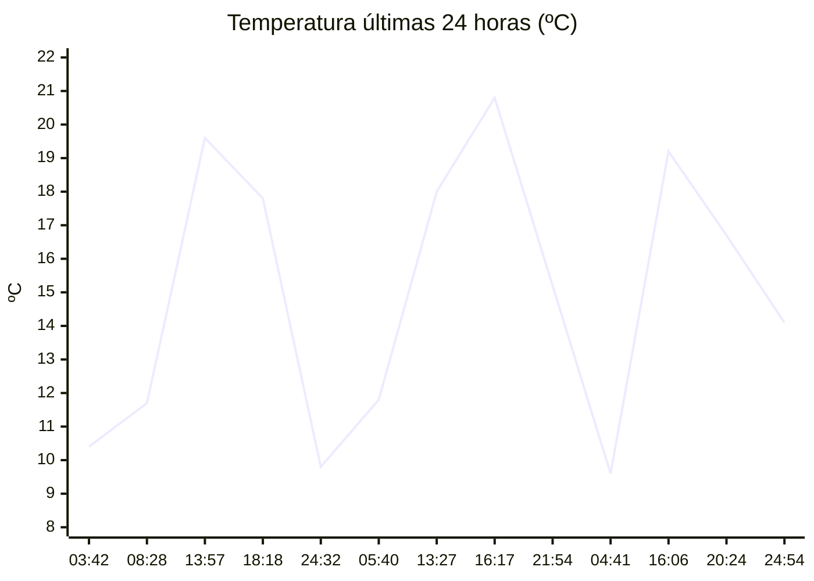

# rem-scrap

Actualización automática del clima para la estación Concarán.

## Últimos datos

| Campo | Valor |
| --- | --- |
| Estación | Concarán |
| Hora | 00:53 |
| Temperatura | 14,1 ºC |
| Humedad | 77,5 % |
| Lluvia (1h) | 0,0 mm |
| Lluvia (24h) | 0,0 mm |
| Lluvia (30d) | 36,0 mm |
| Lluvia (Año) | 548,1 mm |
| Rad. Solar | 0,0 W/m2 |
| Temp Max Hoy | 20 ºC a las 17:44 |
| Temp Min Hoy | 9 ºC a las 04:09 |
| VPS (VPD) | 0.36 kPa (bajo) |

## Resumen IA

Concarán, 00:53 h – noche fresca y húmeda. La temperatura actual es 14,1 ºC, dentro del rango del día (9 ºC‑20 ºC). El rango térmico es de 11 ºC; el valor de este momento está 5,1 ºC por encima de la mínima y 5,9 ºC por debajo de la máxima, por lo que se aproxima más al extremo bajo del día. La humedad relativa es 77,5 % y el VPD de 0,36 kPa indica un aire poco demandante, con baja transpiración y condiciones que favorecen la proliferación de hongos si el follaje permanece húmedo. No se registró lluvia en la última hora ni en las últimas 24 h, por lo que la humedad del suelo no ha variado recientemente; la precipitación acumulada en 30 d es 36,0 mm y en el año 548,1 mm. La radiación solar es 0,0 W/m2, típica de la madrugada. Recomiendo mantener buena ventilación en los cultivos y evitar riegos nocturnos para prevenir problemas fúngicos.

## Tendencia últimas 24 h

## Fuente

Datos extraídos de [clima.sanluis.gob.ar](https://clima.sanluis.gob.ar/Estacion.aspx?estacion=8).

## Generado automáticamente

Este archivo fue actualizado el 20 de octubre de 2026 a las 03:55:00.
