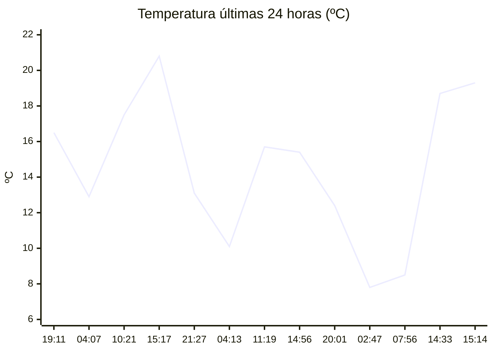

# rem-scrap

Actualización automática del clima para la estación Concarán.

## Últimos datos

| Campo | Valor |
| --- | --- |
| Estación | Concarán |
| Hora | 15:12 |
| Temperatura | 19,3 ºC |
| Humedad | 41,2 % |
| Lluvia (1h) | 0,0 mm |
| Lluvia (24h) | 0,0 mm |
| Lluvia (30d) | 42,8 mm |
| Lluvia (Año) | 554,8 mm |
| Rad. Solar | 263,0 W/m2 |
| Temp Max Hoy | 20 ºC a las 14:52 |
| Temp Min Hoy | 7 ºC a las 04:22 |
| VPS (VPD) | 1.32 kPa (alto) |

## Resumen IA

Estación Concarán, 15:12 h – tarde templada y algo seca, con cielo parcialmente soleado.  

Temperatura actual 19,3 ºC está a solo 0,7 ºC del máximo del día (20 ºC) y a 12,3 ºC de la mínima (7 ºC). El rango térmico del día es de 13 ºC, y la condición actual se aproxima al extremo cálido.  

La humedad relativa es 41,2 % y el VPD registra 1,32 kPa, valor calificado como “alto”. Un VPD entre 1,2 y 1,5 kPa indica aire moderadamente seco; la transpiración de los cultivos será más intensa y el riesgo de estrés hídrico aumenta, aunque no llega a ser crítico.  

No se registró precipitación en la última hora ni en las últimas 24 h; la lluvia acumulada en 30 d es 42,8 mm y en el año 554,8 mm. La radiación solar de 263 W/m² a esa hora muestra una irradiancia media‑alta, favoreciendo la evaporación y el calentamiento del follaje.  

Recomendación: aplicar riego ligero o incrementar la frecuencia de riego y ventilar el cultivo para evitar estrés hídrico.

## Tendencia últimas 24 h

## Fuente

Datos extraídos de [clima.sanluis.gob.ar](https://clima.sanluis.gob.ar/Estacion.aspx?estacion=8).

## Generado automáticamente

Este archivo fue actualizado el 25 de octubre de 2026 a las 06:14:08.
