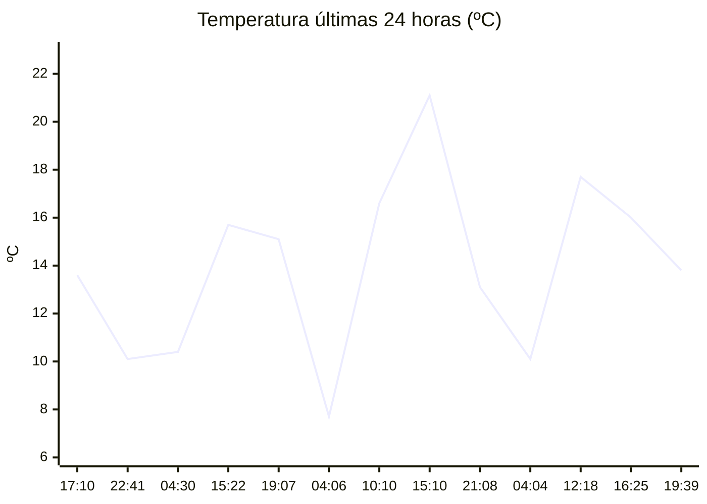

# rem-scrap

Actualización automática del clima para la estación Concarán.

## Últimos datos

| Campo | Valor |
| --- | --- |
| Estación | Concarán |
| Hora | 19:38 |
| Temperatura | 13,8 ºC |
| Humedad | 84,4 % |
| Lluvia (1h) | 0,0 mm |
| Lluvia (24h) | 7,6 mm |
| Lluvia (30d) | 36,0 mm |
| Lluvia (Año) | 548,1 mm |
| Rad. Solar | 0,0 W/m2 |
| Temp Max Hoy | 20 ºC a las 14:28 |
| Temp Min Hoy | 9 ºC a las 06:20 |
| VPS (VPD) | 0.25 kPa (bajo) |

## Resumen IA

Concarán, 19:38 h – tarde fresca y húmeda. La temperatura actual es 13,8 ºC; el rango térmico del día fue de 11 ºC (máx 20 ºC a las 14:28 y mín 9 ºC a las 06:20). Con 13,8 ºC está 4,8 ºC por encima de la mínima y 6,2 ºC por debajo de la máxima, por lo que se acerca más al extremo frío del día. La humedad relativa es alta, 84,4 %, y el VPD de 0,25 kPa está muy por debajo del umbral de 0,8 kPa, indicando aire poco demandante: la transpiración de las plantas será baja y el riesgo de desarrollo de hongos aumenta por la humedad estancada. No se registró lluvia en la última hora, pero en las últimas 24 h cayó 7,6 mm, lo que contribuye a la humedad del suelo y del aire. La radiación solar está en 0 W/m2, ya que el sol se ha puesto. Recomiendo mantener buena ventilación y evitar riegos nocturnos para reducir la humedad foliar y prevenir enfermedades.

## Tendencia últimas 24 h

## Fuente

Datos extraídos de [clima.sanluis.gob.ar](https://clima.sanluis.gob.ar/Estacion.aspx?estacion=8).

## Generado automáticamente

Este archivo fue actualizado el 16 de octubre de 2026 a las 10:39:18.
