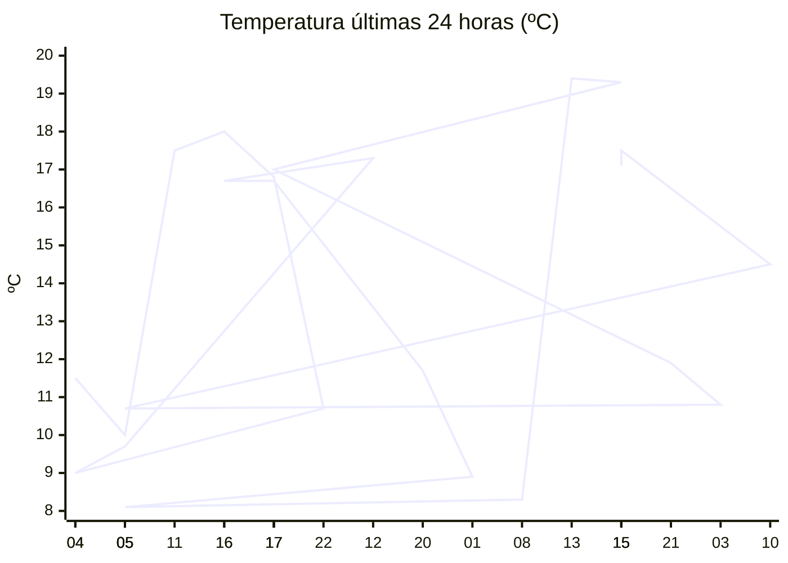

# rem-scrap

Actualización automática del clima para la estación Concarán.

## Últimos datos

| Campo | Valor |
| --- | --- |
| Estación | Concarán |
| Hora | 15:44 |
| Temperatura | 17,1 ºC |
| Humedad | 59,7 % |
| Lluvia (1h) | 0,0 mm |
| Lluvia (24h) | 0,0 mm |
| Lluvia (30d) | 36,8 mm |
| Lluvia (Año) | 534,2 mm |
| Rad. Solar | 251,0 W/m2 |
| Temp Max Hoy | 18 ºC a las 13:24 |
| Temp Min Hoy | 10 ºC a las 07:01 |
| VPS (VPD) | 0.79 kPa (bajo) |

## Resumen IA

Estación Concarán, 15:44 h – tarde fresca y ligeramente húmeda.  
Temperatura actual 17,1 ºC está a solo 0,9 ºC del máximo de 18 ºC y a 7,1 ºC del mínimo de 10 ºC; el rango térmico del día es de 8 ºC, por lo que la temperatura del momento se aproxima al extremo máximo.  
Humedad relativa 59,7 % y VPD 0,79 kPa (bajo) indican aire con baja demanda hídrica; la transpiración de los cultivos será reducida y el ambiente favorece la persistencia de humedad en la superficie, incrementando el riesgo de desarrollo de hongos.  
No se registró lluvia en la última hora ni en las últimas 24 h; el acumulado de 30 días es 36,8 mm, lo que muestra una condición seca reciente. La radiación solar de 251,0 W/m2 a esta hora sugiere sol moderado‑alto, suficiente para la fotosíntesis pero sin sobrecalentamiento.  
Recomendación: mantener una ventilación ligera y aplicar riego preventivo moderado para evitar estrés hídrico y minimizar la aparición de enfermedades foliares.

## Tendencia últimas 24 h

## Fuente

Datos extraídos de [clima.sanluis.gob.ar](https://clima.sanluis.gob.ar/Estacion.aspx?estacion=8).

## Generado automáticamente

Este archivo fue actualizado el 11 de octubre de 2026 a las 06:45:26.
