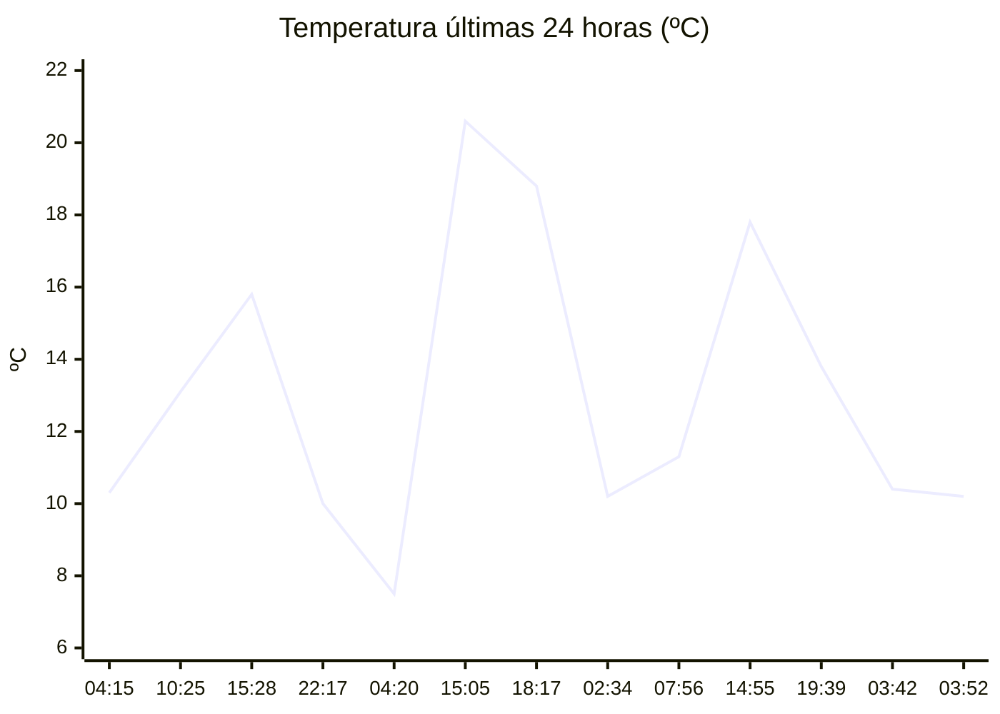

# rem-scrap

Actualización automática del clima para la estación Concarán.

## Últimos datos

| Campo | Valor |
| --- | --- |
| Estación | Concarán |
| Hora | 03:51 |
| Temperatura | 10,2 ºC |
| Humedad | 99,7 % |
| Lluvia (1h) | 0,0 mm |
| Lluvia (24h) | 7,6 mm |
| Lluvia (30d) | 36,0 mm |
| Lluvia (Año) | 548,1 mm |
| Rad. Solar | 0,0 W/m2 |
| Temp Max Hoy | 12 ºC a las 00:00 |
| Temp Min Hoy | 11 ºC a las 02:54 |
| VPS (VPD) | 0 kPa (bajo) |

## Resumen IA

Estación Concarán, 03:51 hrs: madrugada fría y extremadamente húmeda. La temperatura actual es 10,2 ºC, mientras que la máxima del día fue 12 ºC y la mínima 11 ºC a las 02:54. El rango térmico del día es de 1 ºC; la temperatura actual está por debajo de la mínima registrada, por lo que se aproxima al extremo frío. La humedad relativa está al 99,7 % y el VPD (vps) es 0 kPa, lo que indica aire saturado, transpiración casi nula y alta propensión a la proliferación de hongos. En los últimos 24 h se acumularon 7,6 mm de lluvia, sin precipitación en la última hora, lo que mantiene el suelo húmedo pero la atmósfera sin aporte de humedad adicional. La radiación solar es 0 W/m2, coherente con la hora nocturna, por lo que no hay aporte de energía solar. Recomiendo ventilación ligera nocturna y, si el cultivo es sensible, aplicar medidas preventivas contra hongos.

## Tendencia últimas 24 h

## Fuente

Datos extraídos de [clima.sanluis.gob.ar](https://clima.sanluis.gob.ar/Estacion.aspx?estacion=8).

## Generado automáticamente

Este archivo fue actualizado el 17 de octubre de 2026 a las 06:52:14.
