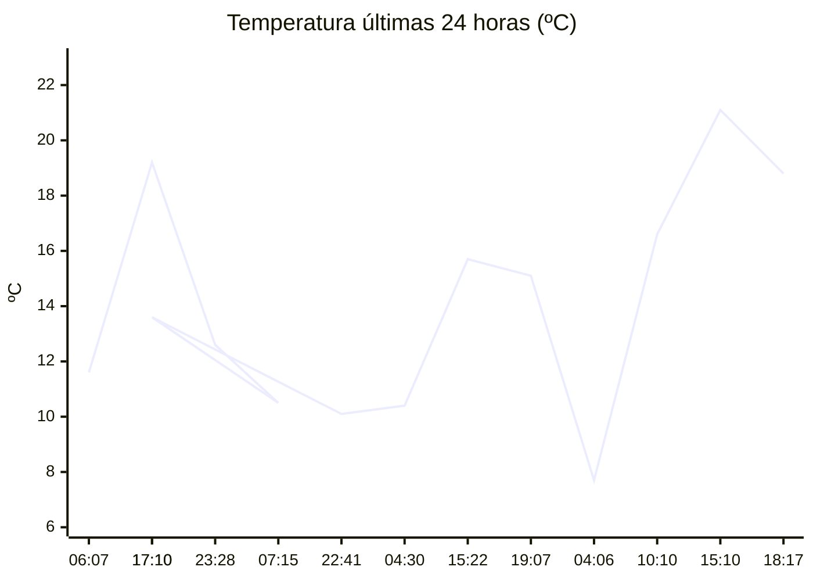

# rem-scrap

Actualización automática del clima para la estación Concarán.

## Últimos datos

| Campo | Valor |
| --- | --- |
| Estación | Concarán |
| Hora | 18:16 |
| Temperatura | 18,8 ºC |
| Humedad | 45,0 % |
| Lluvia (1h) | 0,0 mm |
| Lluvia (24h) | 0,0 mm |
| Lluvia (30d) | 28,5 mm |
| Lluvia (Año) | 540,5 mm |
| Rad. Solar | 95,0 W/m2 |
| Temp Max Hoy | 22 ºC a las 15:13 |
| Temp Min Hoy | 5 ºC a las 06:14 |
| VPS (VPD) | 1.19 kPa (ideal) |

## Resumen IA

Estación Concarán, 18:16 h – tarde fresca y moderadamente seca, con sol tenue.  

Temperatura: la lectura actual de 18,8 ºC está a 3,2 ºC del máximo de 22 ºC alcanzado a las 15:13 y a 13,8 ºC de la mínima de 5 ºC de la madrugada; el rango térmico del día es de 17 ºC y el valor presente se aproxima más al extremo máximo.  

Humedad y vapor: la humedad relativa es 45 % y el VPD de 1,19 kPa se sitúa en el rango “ideal” para la fase vegetativa, lo que indica una demanda hídrica equilibrada y bajo riesgo de estrés por transpiración ni de desarrollo de hongos por exceso de humedad.  

Lluvia y radiación: no se registró lluvia en la última hora ni en las últimas 24 h; el acumulado de 30 d es 28,5 mm, reflejando condiciones secas recientemente. La radiación solar de 95 W/m2, típica de una tarde nublada o con sol bajo, aporta luz moderada.  

Recomendación: mantenga riego ligero al atardecer y asegure buena ventilación para evitar acumulación de humedad en el cultivo.

## Tendencia últimas 24 h

## Fuente

Datos extraídos de [clima.sanluis.gob.ar](https://clima.sanluis.gob.ar/Estacion.aspx?estacion=8).

## Generado automáticamente

Este archivo fue actualizado el 15 de octubre de 2026 a las 09:17:39.
