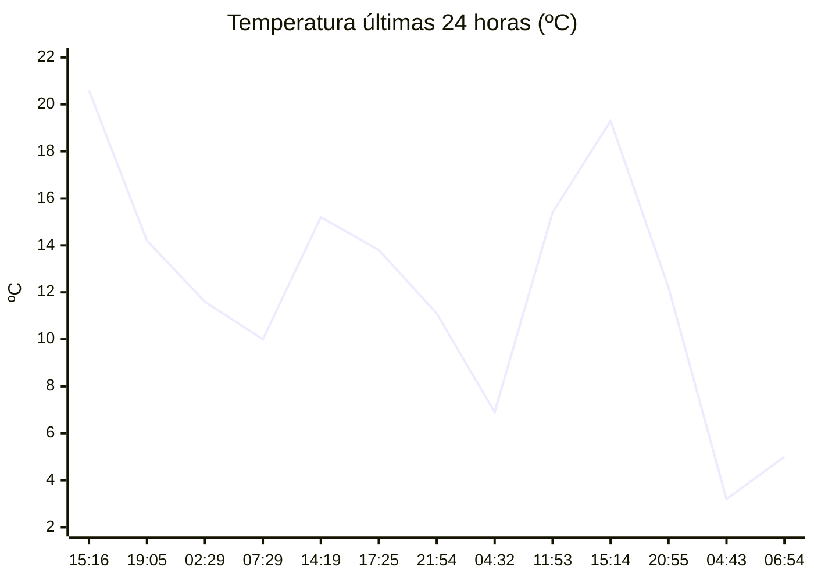

# rem-scrap

Actualización automática del clima para la estación Concarán.

## Últimos datos

| Campo | Valor |
| --- | --- |
| Estación | Concarán |
| Hora | 06:53 |
| Temperatura | 5,0 ºC |
| Humedad | 99,8 % |
| Lluvia (1h) | 0,0 mm |
| Lluvia (24h) | 0,0 mm |
| Lluvia (30d) | 42,8 mm |
| Lluvia (Año) | 554,8 mm |
| Rad. Solar | 55,0 W/m2 |
| Temp Max Hoy | 8 ºC a las 00:00 |
| Temp Min Hoy | 3 ºC a las 05:03 |
| VPS (VPD) | 0 kPa (bajo) |

## Resumen IA

Estación Concarán, 06:53 – la madrugada se presenta fresca y extremadamente húmeda. La temperatura actual es 5,0 ºC; el rango térmico del día es de 8 ºC a 3 ºC (5 ºC de amplitud). El valor de 5,0 ºC está a 2 ºC de la mínima y a 3 ºC de la máxima, por lo que se aproxima más al extremo bajo. Humedad relativa 99,8 % y VPD 0 kPa indican aire saturado, con mínima demanda de transpiración y alto riesgo de desarrollo de hongos en los cultivos. No se registró lluvia en la última hora ni en las últimas 24 h, por lo que la humedad alta proviene del rocío y la condensación. La radiación solar es de 55 W/m2, típica de una hora temprana con sol débil. En conclusión, se aconseja ventilar los invernaderos o cultivos al aire libre y, de ser necesario, aplicar tratamientos antifúngicos preventivos para evitar problemas de humedad estancada.

## Tendencia últimas 24 h

## Fuente

Datos extraídos de [clima.sanluis.gob.ar](https://clima.sanluis.gob.ar/Estacion.aspx?estacion=8).

## Generado automáticamente

Este archivo fue actualizado el 26 de octubre de 2026 a las 09:54:38.
