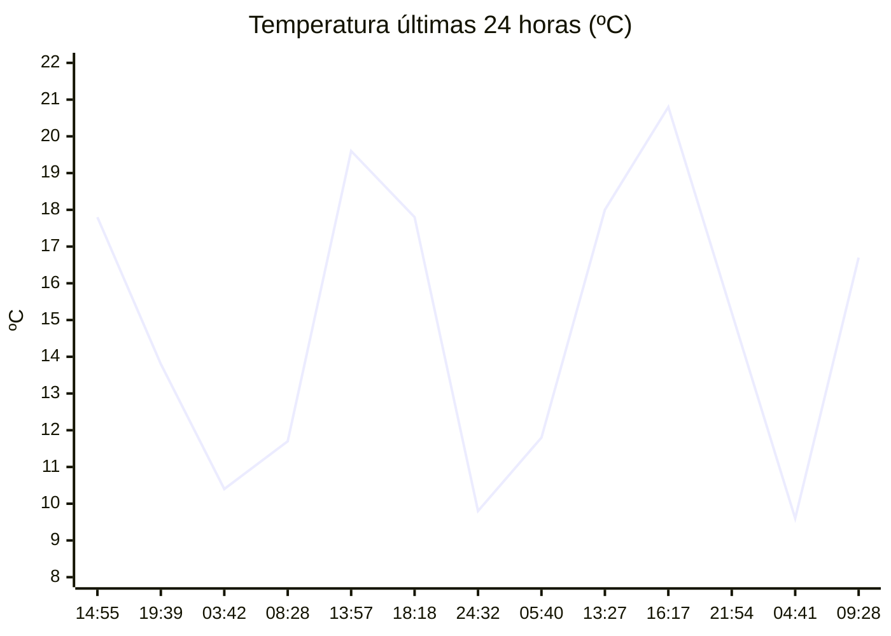

# rem-scrap

Actualización automática del clima para la estación Concarán.

## Últimos datos

| Campo | Valor |
| --- | --- |
| Estación | Concarán |
| Hora | 09:26 |
| Temperatura | 16,7 ºC |
| Humedad | 64,9 % |
| Lluvia (1h) | 0,0 mm |
| Lluvia (24h) | 0,0 mm |
| Lluvia (30d) | 36,0 mm |
| Lluvia (Año) | 548,1 mm |
| Rad. Solar | 481,0 W/m2 |
| Temp Max Hoy | 17 ºC a las 08:45 |
| Temp Min Hoy | 9 ºC a las 04:09 |
| VPS (VPD) | 0.67 kPa (bajo) |

## Resumen IA

Estación Concarán, 09:26 h – la mañana se presenta fresca y ligeramente húmeda. La temperatura actual es 16,7 ºC, apenas 0,3 ºC por debajo de la máxima del día (17 ºC) y 7,7 ºC por encima de la mínima (9 ºC); el rango térmico del día es de 8 ºC y el momento se aproxima al extremo máximo. La humedad relativa está en 64,9 % y el VPD es 0,67 kPa, un valor bajo (< 0,8 kPa) que indica poco estrés hídrico para las plantas pero favorece la retención de humedad en el follaje, aumentando el riesgo de enfermedades fúngicas. No se registró lluvia en la última hora ni en las últimas 24 h; el total de precipitación del mes es 36,0 mm y del año 548,1 mm, por lo que el suelo conserva humedad residual. La radiación solar de 481 W/m2 a esta hora sugiere un buen nivel de luz para el desarrollo vegetativo, aunque todavía no ha alcanzado su pico. Recomiendo mantener una ventilación ligera y, si el cultivo es sensible a hongos, aplicar un fungicida preventivo o mejorar la circulación del aire.

## Tendencia últimas 24 h

## Fuente

Datos extraídos de [clima.sanluis.gob.ar](https://clima.sanluis.gob.ar/Estacion.aspx?estacion=8).

## Generado automáticamente

Este archivo fue actualizado el 19 de octubre de 2026 a las 12:28:04.
