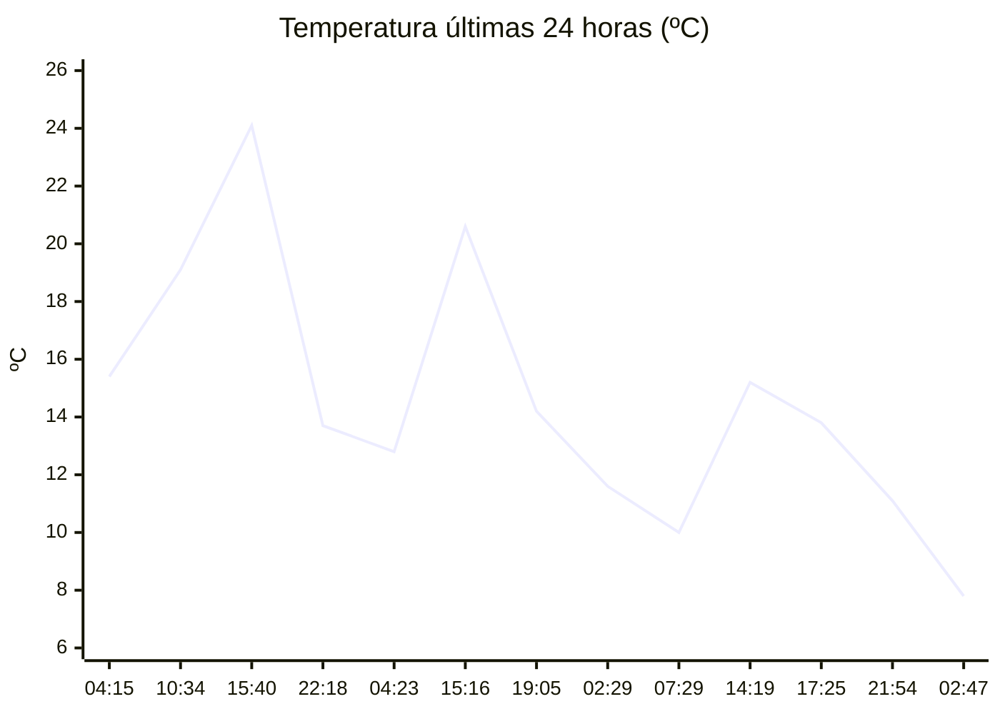

# rem-scrap

Actualización automática del clima para la estación Concarán.

## Últimos datos

| Campo | Valor |
| --- | --- |
| Estación | Concarán |
| Hora | 02:46 |
| Temperatura | 7,8 ºC |
| Humedad | 99,8 % |
| Lluvia (1h) | 0,0 mm |
| Lluvia (24h) | 2,1 mm |
| Lluvia (30d) | 42,8 mm |
| Lluvia (Año) | 554,8 mm |
| Rad. Solar | 0,0 W/m2 |
| Temp Max Hoy | 9 ºC a las 00:09 |
| Temp Min Hoy | 8 ºC a las 01:58 |
| VPS (VPD) | 0 kPa (bajo) |

## Resumen IA

Estación Concarán, 02:46 hs: madrugada fresca y extremadamente húmeda, con cielo nublado y sin luz solar.  

Temperatura actual 7,8 ºC está por debajo de la mínima del día (8 ºC a la 01:58) y a 1,2 ºC de la máxima (9 ºC a la 00:09). El rango térmico del día es de 1 ºC; la temperatura del momento se sitúa muy cerca del extremo inferior, incluso ligeramente bajo el valor mínimo registrado.  

Humedad relativa 99,8 % y VPD 0 kPa indican aire poco demandante de agua; la transpiración de las plantas será mínima y el riesgo de desarrollo de hongos por humedad estancada es alto.  

Lluvia en la última hora nula, pero 2,1 mm acumulados en las últimas 24 hs mantienen el suelo húmedo y refuerzan la humedad del aire. Radiación solar 0 W/m2, acorde a la hora nocturna, confirma ausencia de luz directa.  

Recomendación: ventilar suavemente el invernadero y evitar riegos hasta que el VPD aumente y la humedad disminuya.

## Tendencia últimas 24 h

## Fuente

Datos extraídos de [clima.sanluis.gob.ar](https://clima.sanluis.gob.ar/Estacion.aspx?estacion=8).

## Generado automáticamente

Este archivo fue actualizado el 25 de octubre de 2026 a las 05:47:57.
