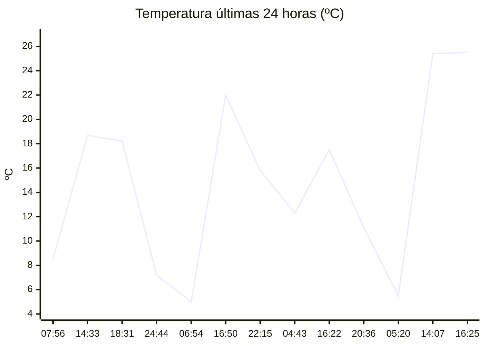

# rem-scrap

Actualización automática del clima para la estación Concarán.

## Últimos datos

| Campo | Valor |
| --- | --- |
| Estación | Concarán |
| Hora | 16:24 |
| Temperatura | 25,5 ºC |
| Humedad | 19,0 % |
| Lluvia (1h) | 0,0 mm |
| Lluvia (24h) | 0,1 mm |
| Lluvia (30d) | 43,0 mm |
| Lluvia (Año) | 555,6 mm |
| Rad. Solar | 177,0 W/m2 |
| Temp Max Hoy | 27 ºC a las 15:17 |
| Temp Min Hoy | 5 ºC a las 05:51 |
| VPS (VPD) | 2.64 kPa (alto) |

## Resumen IA

Estación Concarán, 16:24 hs – tarde cálida y muy seca.  
Temperatura actual 25,5 ºC frente a la máxima de 27 ºC registrada a las 15:17 y la mínima de 5 ºC a las 05:51. El rango térmico del día es de 22 ºC; la temperatura presente se encuentra a 1,5 ºC de la máxima y a 20,5 ºC de la mínima, por lo que está mucho más próxima al extremo caliente.  
Humedad relativa 19 % y VPD 2,64 kPa (valor alto). Un VPD superior a 1,5 kPa indica aire muy seco, alta demanda de transpiración y riesgo de estrés hídrico para los cultivos; la baja humedad refuerza esa condición y reduce la probabilidad de desarrollo de hongos.  
Lluvia en la última hora 0,0 mm y en las últimas 24 h 0,1 mm, por lo que la precipitación reciente es prácticamente nula, lo que mantiene la humedad del aire muy baja. La radiación solar de 177,0 W/m2 a esa hora muestra una intensidad solar moderada‑alta, que incrementa la evaporación.  
Recomendación: aumentar el riego y, si es posible, aplicar sombra o ventilación para mitigar el estrés por sequía.

## Tendencia últimas 24 h

## Fuente

Datos extraídos de [clima.sanluis.gob.ar](https://clima.sanluis.gob.ar/Estacion.aspx?estacion=8).

## Generado automáticamente

Este archivo fue actualizado el 28 de octubre de 2026 a las 07:25:54.
