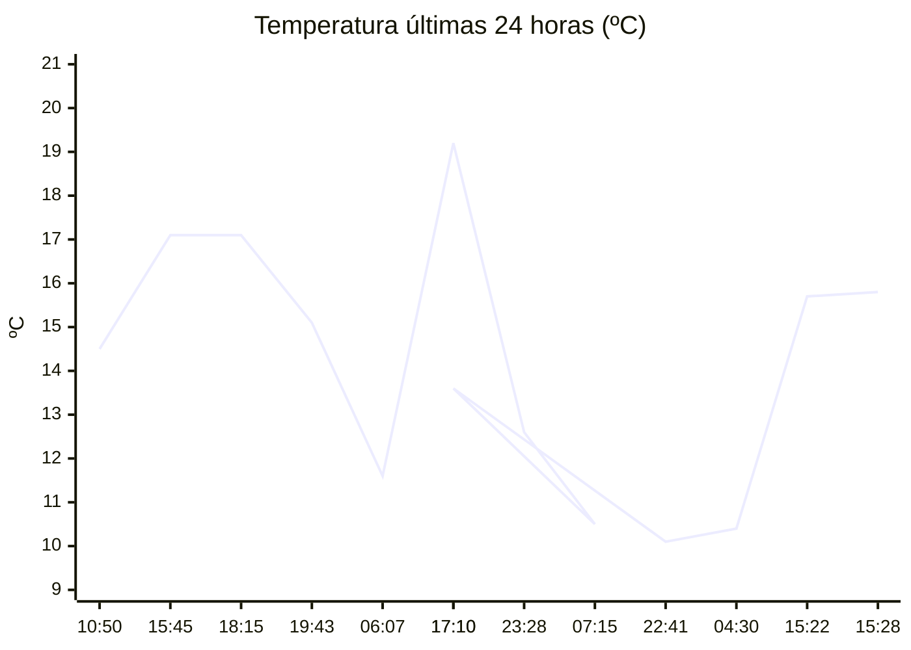

# rem-scrap

Actualización automática del clima para la estación Concarán.

## Últimos datos

| Campo | Valor |
| --- | --- |
| Estación | Concarán |
| Hora | 15:27 |
| Temperatura | 15,8 ºC |
| Humedad | 72,1 % |
| Lluvia (1h) | 0,0 mm |
| Lluvia (24h) | 2,1 mm |
| Lluvia (30d) | 28,6 mm |
| Lluvia (Año) | 540,5 mm |
| Rad. Solar | 529,0 W/m2 |
| Temp Max Hoy | 17 ºC a las 12:41 |
| Temp Min Hoy | 9 ºC a las 01:15 |
| VPS (VPD) | 0.5 kPa (bajo) |

## Resumen IA

Estación Concarán, 15:27 – tarde fresca y húmeda, con cielo parcialmente soleado.  

Temperatura actual 15,8 ºC se sitúa cerca del máximo del día (17 ºC) y bastante por encima del mínimo (9 ºC); el rango térmico del día es de 8 ºC y la medida actual está a 1,2 ºC del tope y a 6,8 ºC del valle, por lo que se aproxima más al extremo máximo.  

Humedad relativa 72,1 % y VPD 0,5 kPa. Un VPD bajo (<0,8 kPa) indica aire poco demandante, transpiración reducida y mayor probabilidad de desarrollo de hongos por humedad estancada, aunque la humedad del aire es alta y cómoda para las plantas.  

Lluvia en la última hora 0,0 mm, pero en 24 h acumuló 2,1 mm, lo que mantiene el suelo ligeramente húmedo y refuerza la humedad atmosférica. Radiación solar 529 W/m² a esta hora sugiere una intensidad solar moderada‑alta, suficiente para fotosíntesis sin sobrecalentamiento.  

Recomendación: vigilar la ventilación del cultivo y aplicar riego solo si el sustrato está seco, evitando excesos que favorezcan hongos.

## Tendencia últimas 24 h

## Fuente

Datos extraídos de [clima.sanluis.gob.ar](https://clima.sanluis.gob.ar/Estacion.aspx?estacion=8).

## Generado automáticamente

Este archivo fue actualizado el 14 de octubre de 2026 a las 06:28:42.
