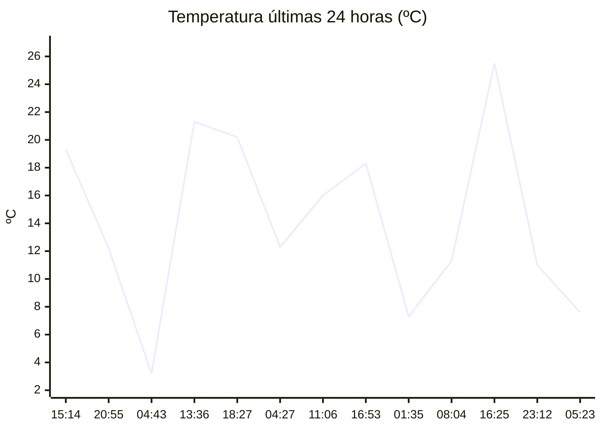

# rem-scrap

Actualización automática del clima para la estación Concarán.

## Últimos datos

| Campo | Valor |
| --- | --- |
| Estación | Concarán |
| Hora | 05:22 |
| Temperatura | 7,6 ºC |
| Humedad | 99,8 % |
| Lluvia (1h) | 0,0 mm |
| Lluvia (24h) | 0,1 mm |
| Lluvia (30d) | 43,0 mm |
| Lluvia (Año) | 555,6 mm |
| Rad. Solar | 0,0 W/m2 |
| Temp Max Hoy | 12 ºC a las 00:06 |
| Temp Min Hoy | 8 ºC a las 04:55 |
| VPS (VPD) | 0 kPa (bajo) |

## Resumen IA

Estación Concarán – 05:22 h. La madrugada se presenta muy fresca y extremadamente húmeda, con el cielo sin radiación solar.

Temperatura: la medida actual es 7,6 ºC, por debajo del mínimo del día (8 ºC a las 04:55) y alejada de la máxima (12 ºC a las 00:06). El rango térmico del día es de 4 ºC; la temperatura actual se sitúa en el extremo más bajo, incluso 0,4 ºC bajo el mínimo registrado.

Humedad y vapor: la humedad relativa es 99,8 % y el VPD indica 0 kPa, lo que significa aire saturado sin déficit de vapor. Para las plantas esto implica transpiración mínima y un riesgo elevado de desarrollo de hongos o enfermedades por la humedad estancada.

Lluvia y radiación: en la última hora no cayó lluvia y en 24 h se registró apenas 0,1 mm, suficiente para mantener la humedad del suelo superficial. La radiación solar es nula, típico de la madrugada.

Recomendación: vigile la aparición de hongos y, si el cultivo es sensible, aumente la ventilación o reduzca la densidad de la cubierta para favorecer el secado.

## Tendencia últimas 24 h

## Fuente

Datos extraídos de [clima.sanluis.gob.ar](https://clima.sanluis.gob.ar/Estacion.aspx?estacion=8).

## Generado automáticamente

Este archivo fue actualizado el 29 de octubre de 2026 a las 08:23:38.
