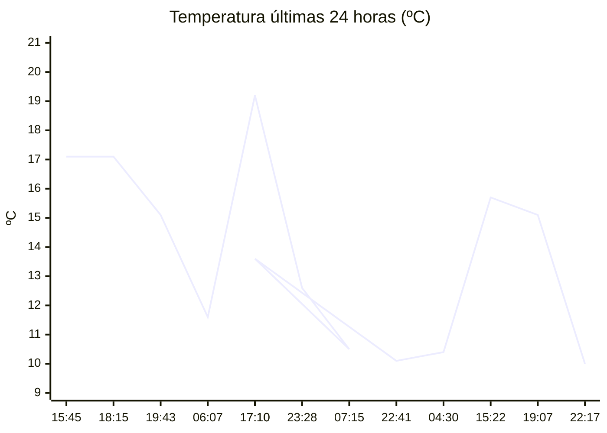

# rem-scrap

Actualización automática del clima para la estación Concarán.

## Últimos datos

| Campo | Valor |
| --- | --- |
| Estación | Concarán |
| Hora | 22:16 |
| Temperatura | 10,0 ºC |
| Humedad | 99,8 % |
| Lluvia (1h) | 0,0 mm |
| Lluvia (24h) | 2,0 mm |
| Lluvia (30d) | 28,6 mm |
| Lluvia (Año) | 540,5 mm |
| Rad. Solar | 0,0 W/m2 |
| Temp Max Hoy | 18 ºC a las 17:35 |
| Temp Min Hoy | 9 ºC a las 01:15 |
| VPS (VPD) | 0 kPa (bajo) |

## Resumen IA

Concarán, 22:16 h – noche fresca y extremadamente húmeda. La temperatura actual es 10,0 ºC, con una máxima de 18 ºC a las 17:35 y una mínima de 9 ºC a la 01:15; el rango térmico del día es de 9 ºC y el valor presente está a solo 1 ºC de la mínima, por lo que el aire se encuentra más cercano al frío nocturno que al calor diurno. La humedad relativa es 99,8 % y el VPD (vps) registra 0 kPa, lo que indica saturación total del vapor: la transpiración de las plantas será mínima y el ambiente favorece la aparición de hongos por falta de demanda de agua. No hubo lluvia en la última hora, pero en las últimas 24 h cayó 2,0 mm, lo que contribuye a la humedad casi absoluta. La radiación solar está en 0 W/m2, típica de la hora nocturna, sin aporte de energía solar. Recomiendo ventilar el cultivo durante las horas tempranas del día para reducir la humedad y prevenir enfermedades fúngicas.

## Tendencia últimas 24 h

## Fuente

Datos extraídos de [clima.sanluis.gob.ar](https://clima.sanluis.gob.ar/Estacion.aspx?estacion=8).

## Generado automáticamente

Este archivo fue actualizado el 15 de octubre de 2026 a las 01:17:23.
