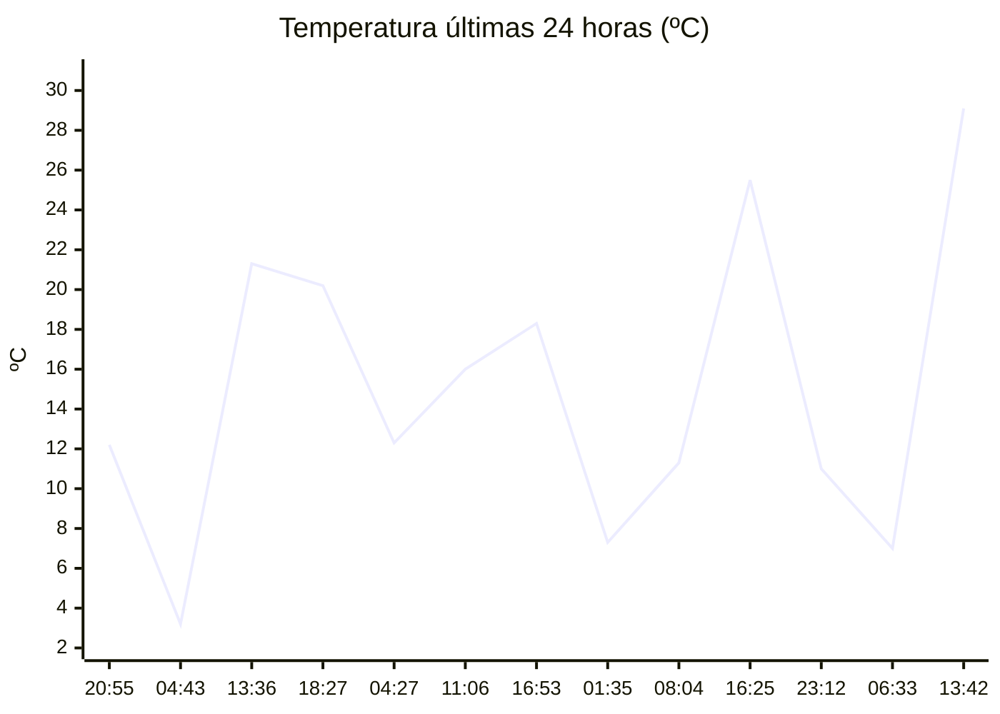

# rem-scrap

Actualización automática del clima para la estación Concarán.

## Últimos datos

| Campo | Valor |
| --- | --- |
| Estación | Concarán |
| Hora | 13:41 |
| Temperatura | 29,1 ºC |
| Humedad | 20,8 % |
| Lluvia (1h) | 0,0 mm |
| Lluvia (24h) | 0,0 mm |
| Lluvia (30d) | 43,0 mm |
| Lluvia (Año) | 555,6 mm |
| Rad. Solar | 369,0 W/m2 |
| Temp Max Hoy | 28 ºC a las 12:59 |
| Temp Min Hoy | 7 ºC a las 06:35 |
| VPS (VPD) | 3.19 kPa (alto) |

## Resumen IA

Concarán, 13:41 – la tarde se muestra calurosa y muy seca. La temperatura actual es 29,1 ºC, superando la máxima del día (28 ºC a 12:59) y muy alejada de la mínima (7 ºC a 06:35). El rango térmico del día es de 21 ºC y el valor presente se sitúa en el extremo superior, 1,1 ºC por encima del máximo registrado. La humedad relativa está en 20,8 % y el VPD alcanza 3,19 kPa, un nivel alto que indica aire extremadamente seco y potencial estrés hídrico para el cultivo; la transpiración será intensa y la probabilidad de desecación de tejidos es alta. No se registró lluvia en la última hora ni en las últimas 24 h, por lo que la humedad del suelo no ha recibido aporte reciente. La radiación solar de 369 W/m2 a la hora del almuerzo confirma una intensidad solar moderada‑alta, favoreciendo el calentamiento del sustrato. Se recomienda aplicar riego profundo y, si es posible, ofrecer sombra parcial o ventilación para mitigar el estrés por déficit hídrico.

## Tendencia últimas 24 h

## Fuente

Datos extraídos de [clima.sanluis.gob.ar](https://clima.sanluis.gob.ar/Estacion.aspx?estacion=8).

## Generado automáticamente

Este archivo fue actualizado el 29 de octubre de 2026 a las 04:42:59.
