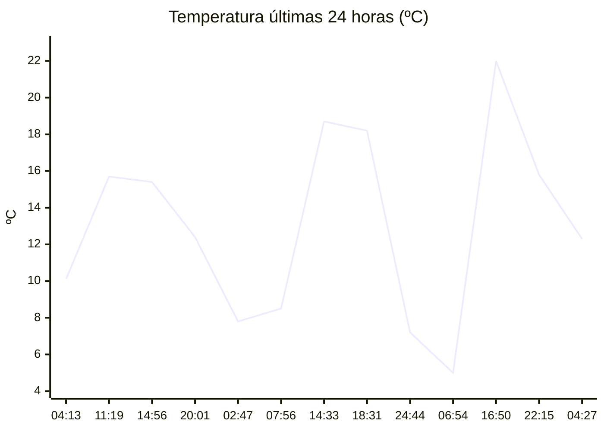

# rem-scrap

Actualización automática del clima para la estación Concarán.

## Últimos datos

| Campo | Valor |
| --- | --- |
| Estación | Concarán |
| Hora | 04:26 |
| Temperatura | 12,3 ºC |
| Humedad | 91,6 % |
| Lluvia (1h) | 0,0 mm |
| Lluvia (24h) | 0,0 mm |
| Lluvia (30d) | 42,8 mm |
| Lluvia (Año) | 554,8 mm |
| Rad. Solar | 0,0 W/m2 |
| Temp Max Hoy | 15 ºC a las 00:20 |
| Temp Min Hoy | 11 ºC a las 03:23 |
| VPS (VPD) | 0.12 kPa (bajo) |

## Resumen IA

Estación Concarán, 04:26 h – madrugada fresca y muy húmeda.  

Temperatura actual 12,3 ºC, dentro del rango del día de 15 ºC máximo a 00:20 y 11 ºC mínimo a 03:23; el rango térmico es de 4 ºC. El valor de 12,3 ºC está mucho más próximo al mínimo (≈1,3 ºC de diferencia) que al máximo (≈2,7 ºC).  

La humedad relativa es 91,6 % y el VPD (vps) es 0,12 kPa, claramente bajo el umbral de 0,8 kPa. Ese nivel indica aire con poca demanda de vapor, lo que reduce la transpiración de las plantas pero favorece la persistencia de humedad en el follaje, aumentando el riesgo de hongos.  

No se registró lluvia en la última hora ni en las últimas 24 h; sin embargo, la humedad sigue alta por la baja temperatura y la ausencia de sol. La radiación solar es 0,0 W/m2, correspondiente a la oscuridad nocturna.  

Recomendación: mantener una ventilación ligera durante la madrugada para romper la capa de humedad y evitar problemas fúngicos; riego solo si el suelo está seco.

## Tendencia últimas 24 h

## Fuente

Datos extraídos de [clima.sanluis.gob.ar](https://clima.sanluis.gob.ar/Estacion.aspx?estacion=8).

## Generado automáticamente

Este archivo fue actualizado el 27 de octubre de 2026 a las 07:27:31.
