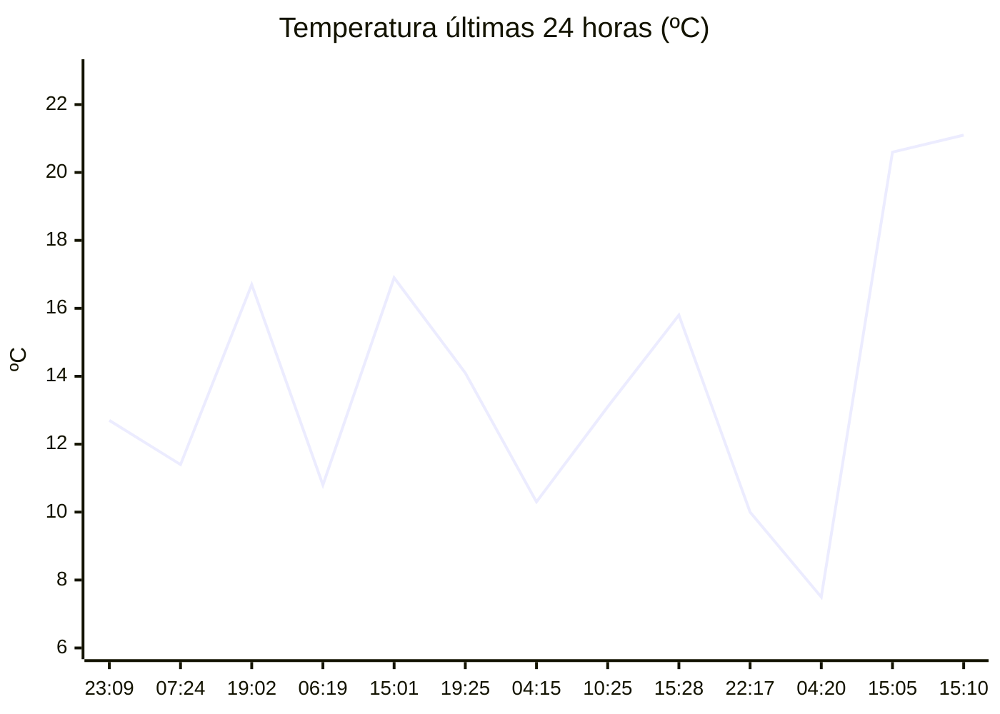

# rem-scrap

Actualización automática del clima para la estación Concarán.

## Últimos datos

| Campo | Valor |
| --- | --- |
| Estación | Concarán |
| Hora | 15:09 |
| Temperatura | 21,1 ºC |
| Humedad | 39,6 % |
| Lluvia (1h) | 0,0 mm |
| Lluvia (24h) | 0,0 mm |
| Lluvia (30d) | 28,5 mm |
| Lluvia (Año) | 540,5 mm |
| Rad. Solar | 769,0 W/m2 |
| Temp Max Hoy | 21 ºC a las 14:15 |
| Temp Min Hoy | 5 ºC a las 06:14 |
| VPS (VPD) | 1.51 kPa (alto) |

## Resumen IA

Estación Concarán, 15:09 h – la tarde se presenta cálida y seca.  
Temperatura actual 21,1 ºC está prácticamente en el máximo del día (21 ºC a las 14:15) y muy alejada del mínimo de 5 ºC; el rango térmico del día es de 16 ºC y la temperatura del momento se aproxima al extremo superior.  
La humedad relativa es 39,6 % y el VPD es 1,51 kPa, valor clasificado como alto: indica aire muy seco, con fuerte demanda hídrica para las plantas y riesgo de estrés por transpiración reducida.  
No se registró lluvia en la última hora ni en las últimas 24 h; la ausencia de precipitación refuerza la sequedad del ambiente. La radiación solar de 769 W/m2 a esta hora del día evidencia una radiación intensa, típica de una tarde despejada.  
Recomendación: incrementar la irrigación y, si es posible, aplicar sombra parcial o ventilar para aliviar el estrés hídrico de los cultivos.

## Tendencia últimas 24 h

## Fuente

Datos extraídos de [clima.sanluis.gob.ar](https://clima.sanluis.gob.ar/Estacion.aspx?estacion=8).

## Generado automáticamente

Este archivo fue actualizado el 15 de octubre de 2026 a las 06:10:49.
