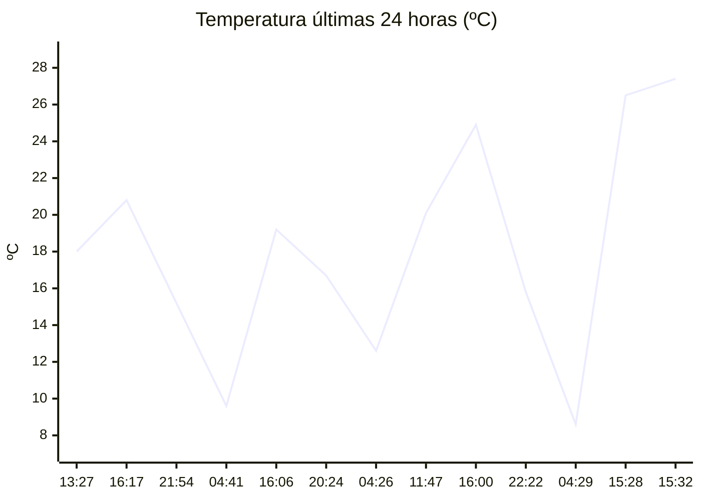

# rem-scrap

Actualización automática del clima para la estación Concarán.

## Últimos datos

| Campo | Valor |
| --- | --- |
| Estación | Concarán |
| Hora | 15:31 |
| Temperatura | 27,4 ºC |
| Humedad | 35,6 % |
| Lluvia (1h) | 0,0 mm |
| Lluvia (24h) | 0,0 mm |
| Lluvia (30d) | 36,0 mm |
| Lluvia (Año) | 548,1 mm |
| Rad. Solar | 648,0 W/m2 |
| Temp Max Hoy | 28 ºC a las 14:42 |
| Temp Min Hoy | 7 ºC a las 06:36 |
| VPS (VPD) | 2.35 kPa (alto) |

## Resumen IA

Estación Concarán, 15:31 – la tarde se presenta calurosa y muy seca.  

Temperatura actual 27,4 ºC está muy próxima al máximo del día (28 ºC) y lejos de la mínima (7 ºC); el rango térmico del día es de 21 ºC y la temperatura actual se sitúa a apenas 0,6 ºC del extremo máximo.  

La humedad relativa es de 35,6 %, lo que indica un aire bastante seco. El VPD reportado es 2,35 kPa, valor superior a 1,5 kPa, lo que implica un ambiente muy seco y un riesgo de estrés hídrico para las plantas, con transpiración alta y mayor vulnerabilidad a deshidratación.  

No se registró lluvia en la última hora ni en las últimas 24 h; la precipitación acumulada en 30 d es de 36,0 mm, sin efecto inmediato sobre la humedad del momento. La radiación solar de 648 W/m² a esta hora del día es intensa, favoreciendo el calentamiento del suelo y la evaporación.  

Recomendación: aumente el riego y, si es posible, mejore la ventilación o sombra parcial para mitigar el estrés por alta demanda de agua.

## Tendencia últimas 24 h

## Fuente

Datos extraídos de [clima.sanluis.gob.ar](https://clima.sanluis.gob.ar/Estacion.aspx?estacion=8).

## Generado automáticamente

Este archivo fue actualizado el 21 de octubre de 2026 a las 06:32:11.
