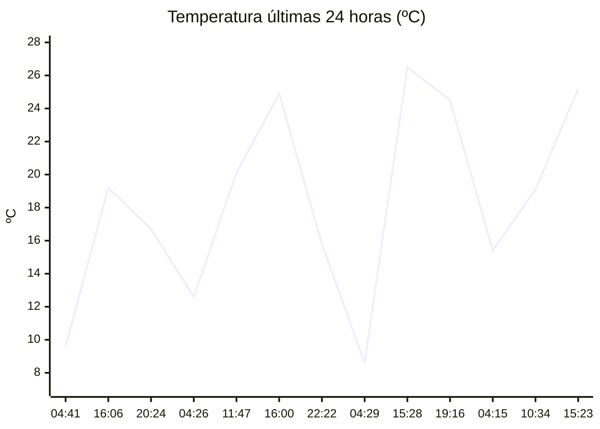

# rem-scrap

Actualización automática del clima para la estación Concarán.

## Últimos datos

| Campo | Valor |
| --- | --- |
| Estación | Concarán |
| Hora | 15:22 |
| Temperatura | 25,2 ºC |
| Humedad | 56,2 % |
| Lluvia (1h) | 0,0 mm |
| Lluvia (24h) | 4,6 mm |
| Lluvia (30d) | 40,6 mm |
| Lluvia (Año) | 552,6 mm |
| Rad. Solar | 306,0 W/m2 |
| Temp Max Hoy | 25 ºC a las 14:57 |
| Temp Min Hoy | 14 ºC a las 06:39 |
| VPS (VPD) | 1.4 kPa (alto) |

## Resumen IA

Concarán, 15:22 – tarde cálida y algo seca. La temperatura actual es 25,2 ºC, ligeramente por encima de la máxima del día (25 ºC a las 14:57). El rango térmico del día es de 11 ºC (14 ºC – 25 ºC) y el momento se sitúa muy próximo al extremo alto.

La humedad relativa registra 56,2 % y el VPD es 1,4 kPa, valor catalogado como alto. Indica que el aire está seco y que las plantas pueden experimentar estrés por transpiración, aunque no llega al nivel crítico de >1,5 kPa. El nivel de humedad no es suficiente para favorecer la proliferación de hongos, pero sí requiere precaución en el manejo hídrico.

En la última hora no hubo precipitación (0,0 mm), pero en las últimas 24 h cayó 4,6 mm, lo que eleva la humedad del suelo sin eliminar el déficit atmosférico. La radiación solar a 306 W/m2 a esta hora del día indica una intensidad solar moderada‑alta.

Recomendación: aumente la frecuencia o el caudal de riego y mantenga una buena ventilación para reducir el estrés hídrico de los cultivos.

## Tendencia últimas 24 h

## Fuente

Datos extraídos de [clima.sanluis.gob.ar](https://clima.sanluis.gob.ar/Estacion.aspx?estacion=8).

## Generado automáticamente

Este archivo fue actualizado el 22 de octubre de 2026 a las 06:23:25.
