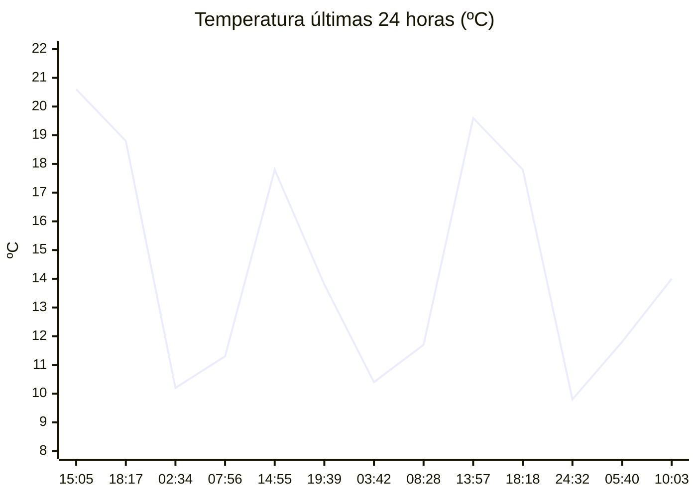

# rem-scrap

Actualización automática del clima para la estación Concarán.

## Últimos datos

| Campo | Valor |
| --- | --- |
| Estación | Concarán |
| Hora | 10:02 |
| Temperatura | 14,0 ºC |
| Humedad | 89,9 % |
| Lluvia (1h) | 0,0 mm |
| Lluvia (24h) | 0,0 mm |
| Lluvia (30d) | 36,0 mm |
| Lluvia (Año) | 548,1 mm |
| Rad. Solar | 180,0 W/m2 |
| Temp Max Hoy | 14 ºC a las 09:50 |
| Temp Min Hoy | 10 ºC a las 00:36 |
| VPS (VPD) | 0.16 kPa (bajo) |

## Resumen IA

Estación Concarán, 10:02 h – se percibe una mañana fresca y muy húmeda.  
Temperatura actual 14,0 ºC coincide con la máxima del día (14 ºC a las 09:50) y está a 4,0 ºC de la mínima de 10 ºC (registro a las 00:36); el rango térmico del día es de 4 ºC y el instante se sitúa en el extremo máximo.  
La humedad relativa es 89,9 % y el VPD es 0,16 kPa, valor muy bajo (<0,8 kPa). Esto indica que el aire tiene poca demanda de agua, favoreciendo una transpiración reducida y aumentando el riesgo de desarrollo de hongos si la humedad se mantiene estancada.  
No se registró precipitación en la última hora ni en las últimas 24 h (0,0 mm), aunque el acumulado de 30 días es 36,0 mm y del año 548,1 mm. La radiación solar de 180,0 W/m2 a las 10 h señala una luz moderada, típica de una mañana nublada o con sol parcial.  
Recomendación: mantenga buena ventilación en el cultivo y evite riegos nocturnos para prevenir problemas fúngicos.

## Tendencia últimas 24 h

## Fuente

Datos extraídos de [clima.sanluis.gob.ar](https://clima.sanluis.gob.ar/Estacion.aspx?estacion=8).

## Generado automáticamente

Este archivo fue actualizado el 18 de octubre de 2026 a las 01:03:33.
