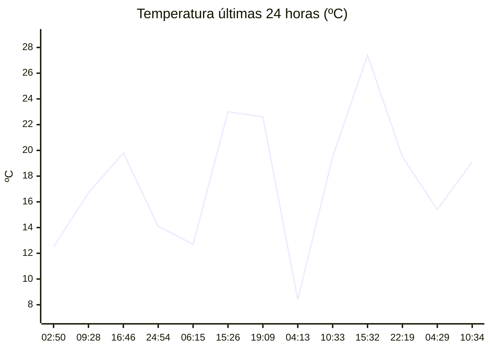

# rem-scrap

Actualización automática del clima para la estación Concarán.

## Últimos datos

| Campo | Valor |
| --- | --- |
| Estación | Concarán |
| Hora | 10:33 |
| Temperatura | 19,1 ºC |
| Humedad | 98,6 % |
| Lluvia (1h) | 0,0 mm |
| Lluvia (24h) | 3,9 mm |
| Lluvia (30d) | 39,9 mm |
| Lluvia (Año) | 551,9 mm |
| Rad. Solar | 349,0 W/m2 |
| Temp Max Hoy | 22 ºC a las 00:01 |
| Temp Min Hoy | 14 ºC a las 06:39 |
| VPS (VPD) | 0.03 kPa (bajo) |

## Resumen IA

Estación Concarán, 10:33 h – mañana fresca y muy húmeda, sin lluvia en la última hora.  

Temperatura actual 19,1 ºC frente a la máxima de 22 ºC y la mínima de 14 ºC; el rango térmico del día es de 8 ºC. El valor del momento está a 2,9 ºC de la máxima y a 5,1 ºC de la mínima, por lo que se aproxima más al extremo superior del día.  

Humedad relativa 98,6 % y VPD 0,03 kPa (valor bajo). Por debajo de 0,8 kPa el aire es poco demandante: la transpiración de los cultivos es mínima y el ambiente favorece la aparición de hongos por humedad estancada.  

Lluvia acumulada en 24 h 3,9 mm, sin precipitación en la última hora, indica suelo todavía húmedo y refuerza la alta humedad del aire. Radiación solar 349 W/m2 a esta hora sugiere una intensidad solar moderada‑alta, suficiente para iniciar la fotosíntesis pero sin secar rápidamente la humedad.  

Recomendación: aumentar la ventilación y evitar riegos adicionales; considerar medidas preventivas contra enfermedades fúngicas.

## Tendencia últimas 24 h

## Fuente

Datos extraídos de [clima.sanluis.gob.ar](https://clima.sanluis.gob.ar/Estacion.aspx?estacion=8).

## Generado automáticamente

Este archivo fue actualizado el 22 de octubre de 2026 a las 01:34:57.
