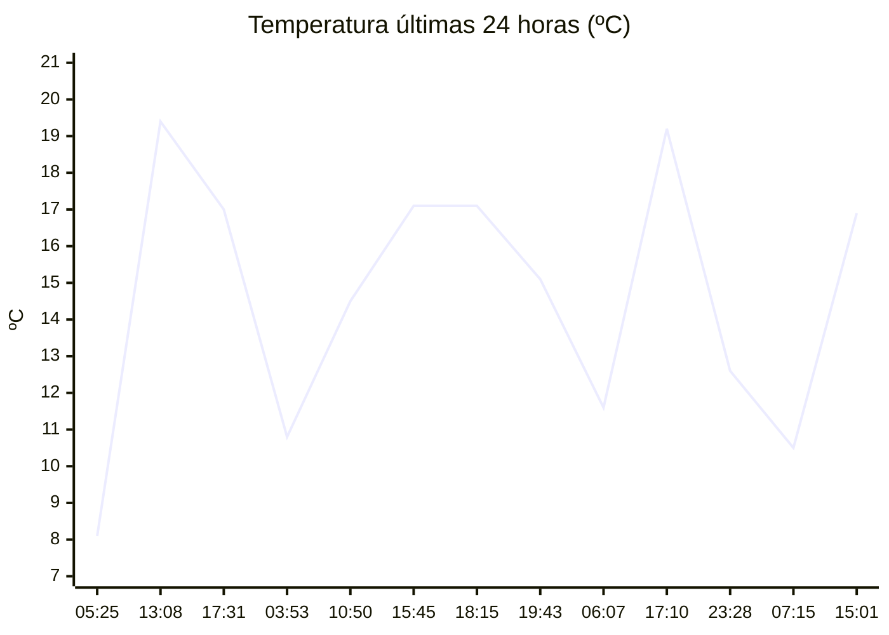

# rem-scrap

Actualización automática del clima para la estación Concarán.

## Últimos datos

| Campo | Valor |
| --- | --- |
| Estación | Concarán |
| Hora | 15:00 |
| Temperatura | 16,9 ºC |
| Humedad | 71,5 % |
| Lluvia (1h) | 0,0 mm |
| Lluvia (24h) | 0,7 mm |
| Lluvia (30d) | 26,5 mm |
| Lluvia (Año) | 538,3 mm |
| Rad. Solar | 165,0 W/m2 |
| Temp Max Hoy | 17 ºC a las 14:58 |
| Temp Min Hoy | 9 ºC a las 05:54 |
| VPS (VPD) | 0.55 kPa (bajo) |

## Resumen IA

Concarán, 15:00 – tarde fresca y algo húmeda. La temperatura actual es 16,9 ºC, apenas 0,1 ºC por debajo de la máxima registrada hoy (17 ºC) y a 7,9 ºC de la mínima (9 ºC). El rango térmico del día es de 8 ºC, y el momento se sitúa muy próximo al extremo máximo. La humedad relativa está en 71,5 % y el VPD es 0,55 kPa, valor bajo que indica poca demanda hídrica del aire; la transpiración de los cultivos será reducida y el riesgo de desarrollo de hongos aumenta por la humedad estancada. En la última hora no cayó lluvia (0,0 mm), pero en las últimas 24 h se registraron 0,7 mm, lo que mantiene la humedad del suelo ligeramente elevada. La radiación solar de 165 W/m2 a esta hora sugiere un sol moderado, sin llegar a ser intenso. Recomiendo mantener una buena ventilación y, si el cultivo es sensible a hongos, aplicar un fungicida preventivo.

## Tendencia últimas 24 h

## Fuente

Datos extraídos de [clima.sanluis.gob.ar](https://clima.sanluis.gob.ar/Estacion.aspx?estacion=8).

## Generado automáticamente

Este archivo fue actualizado el 13 de octubre de 2026 a las 06:01:11.
