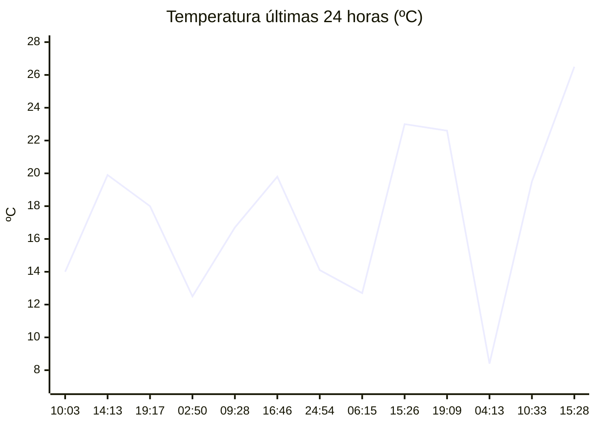

# rem-scrap

Actualización automática del clima para la estación Concarán.

## Últimos datos

| Campo | Valor |
| --- | --- |
| Estación | Concarán |
| Hora | 15:27 |
| Temperatura | 26,5 ºC |
| Humedad | 34,7 % |
| Lluvia (1h) | 0,0 mm |
| Lluvia (24h) | 0,0 mm |
| Lluvia (30d) | 36,0 mm |
| Lluvia (Año) | 548,1 mm |
| Rad. Solar | 522,0 W/m2 |
| Temp Max Hoy | 28 ºC a las 14:42 |
| Temp Min Hoy | 7 ºC a las 06:36 |
| VPS (VPD) | 2.26 kPa (alto) |

## Resumen IA

Concarán, 15:27 – tarde cálida y seca. La temperatura actual de 26,5 ºC está a solo 1,5 ºC del máximo alcanzado hoy (28 ºC) y mucho más alejada del mínimo de 7 ºC; el rango térmico del día es de 21 ºC, y el aire se sitúa claramente próximo al extremo cálido. La humedad relativa es de 34,7 % y el VPD indica 2,26 kPa, un valor alto que señala aire muy seco y una fuerte demanda de transpiración, lo que puede generar estrés hídrico en los cultivos y favorece la evaporación rápida del agua del suelo. No se registró lluvia en la última hora ni en las últimas 24 h, por lo que la humedad del suelo sigue baja; la precipitación acumulada del mes (36,0 mm) y del año (548,1 mm) muestra que la temporada ha sido relativamente húmeda en conjunto, pero no afecta el momento actual. La radiación solar de 522 W/m2 a esa hora indica una intensidad solar media‑alta, reforzando la evaporación y el calentamiento del cultivo. Se recomienda iniciar riegos por la mañana temprano y, si es posible, aplicar sombra parcial o mulching para reducir la pérdida de humedad y evitar estrés hídrico.

## Tendencia últimas 24 h

## Fuente

Datos extraídos de [clima.sanluis.gob.ar](https://clima.sanluis.gob.ar/Estacion.aspx?estacion=8).

## Generado automáticamente

Este archivo fue actualizado el 21 de octubre de 2026 a las 06:28:23.
