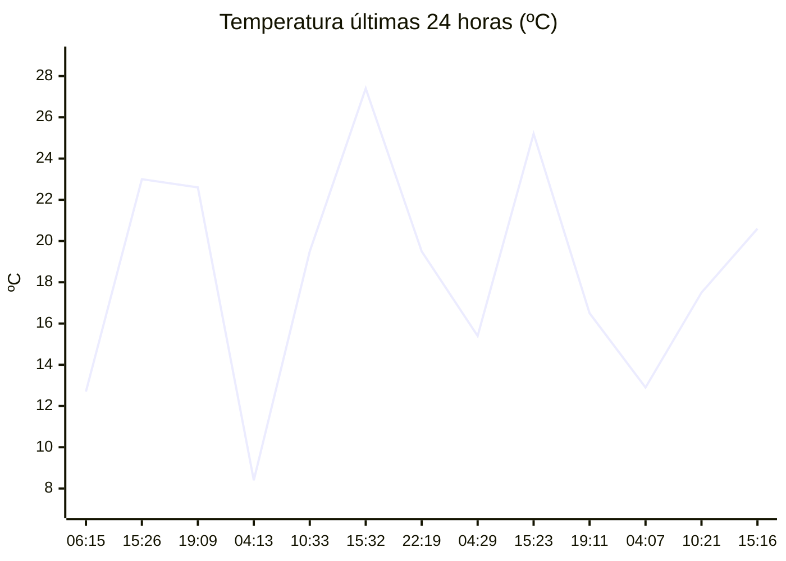

# rem-scrap

Actualización automática del clima para la estación Concarán.

## Últimos datos

| Campo | Valor |
| --- | --- |
| Estación | Concarán |
| Hora | 15:15 |
| Temperatura | 20,6 ºC |
| Humedad | 52,1 % |
| Lluvia (1h) | 0,0 mm |
| Lluvia (24h) | 0,0 mm |
| Lluvia (30d) | 40,6 mm |
| Lluvia (Año) | 552,6 mm |
| Rad. Solar | 638,0 W/m2 |
| Temp Max Hoy | 21 ºC a las 12:50 |
| Temp Min Hoy | 12 ºC a las 06:21 |
| VPS (VPD) | 1.16 kPa (ideal) |

## Resumen IA

Concarán, 15:15 – la tarde se presenta cálida y moderadamente húmeda. La temperatura actual es 20,6 ºC, apenas 0,4 ºC por debajo de la máxima de 21 ºC alcanzada al mediodía y a 8,6 ºC de la mínima de 12 ºC de la mañana; el rango térmico del día es de 9 ºC, por lo que el clima está muy próximo al extremo caliente. La humedad relativa está en 52,1 % y el VPD es 1,16 kPa, valor ideal para la fase vegetativa: el aire no está excesivamente seco ni saturado, favoreciendo una transpiración equilibrada y bajo riesgo de enfermedades fúngicas. No se registró precipitación en la última hora ni en las últimas 24 h, de modo que la humedad del suelo no se vio alterada. La radiación solar de 638 W/m² a esa hora indica una intensidad solar alta, típica de una tarde despejada. Recomiendo mantener el riego moderado y, si el cultivo está bajo cubierta, ventilar ligeramente para evitar sobrecalentamiento.

## Tendencia últimas 24 h

## Fuente

Datos extraídos de [clima.sanluis.gob.ar](https://clima.sanluis.gob.ar/Estacion.aspx?estacion=8).

## Generado automáticamente

Este archivo fue actualizado el 23 de octubre de 2026 a las 06:16:57.
