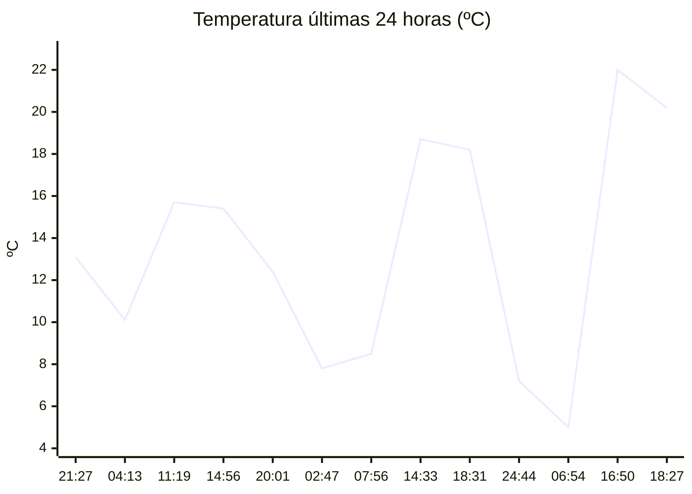

# rem-scrap

Actualización automática del clima para la estación Concarán.

## Últimos datos

| Campo | Valor |
| --- | --- |
| Estación | Concarán |
| Hora | 18:26 |
| Temperatura | 20,2 ºC |
| Humedad | 42,9 % |
| Lluvia (1h) | 0,0 mm |
| Lluvia (24h) | 0,0 mm |
| Lluvia (30d) | 42,8 mm |
| Lluvia (Año) | 554,8 mm |
| Rad. Solar | 37,0 W/m2 |
| Temp Max Hoy | 24 ºC a las 17:18 |
| Temp Min Hoy | 3 ºC a las 05:03 |
| VPS (VPD) | 1.35 kPa (alto) |

## Resumen IA

Estación Concarán, 18:26 – la tarde se muestra fresca y con baja humedad.  

Temperatura actual 20,2 ºC está a 3,8 ºC de la máxima registrada (24 ºC a 17:18) y a 17,2 ºC de la mínima (3 ºC a 05:03); el rango térmico del día es de 21 ºC. El aire se encuentra próximo al extremo cálido del día.  

La humedad relativa es 42,9 %. El VPD de 1,35 kPa indica un ambiente bastante seco; la transpiración de las plantas será más demandante y pueden aparecer signos de estrés hídrico si no se asegura suficiente disponibilidad de agua.  

No hubo precipitación en la última hora ni en las últimas 24 h, pese a los 42,8 mm acumulados en 30 días y 554,8 mm en el año. La radiación solar de 37 W/m² a esta hora es baja, reflejando la disminución de la intensidad solar al caer el sol.  

Recomendación: aplicar un riego ligero y, si es posible, ventilar para reducir el estrés por déficit de humedad.

## Tendencia últimas 24 h

## Fuente

Datos extraídos de [clima.sanluis.gob.ar](https://clima.sanluis.gob.ar/Estacion.aspx?estacion=8).

## Generado automáticamente

Este archivo fue actualizado el 26 de octubre de 2026 a las 09:27:20.
