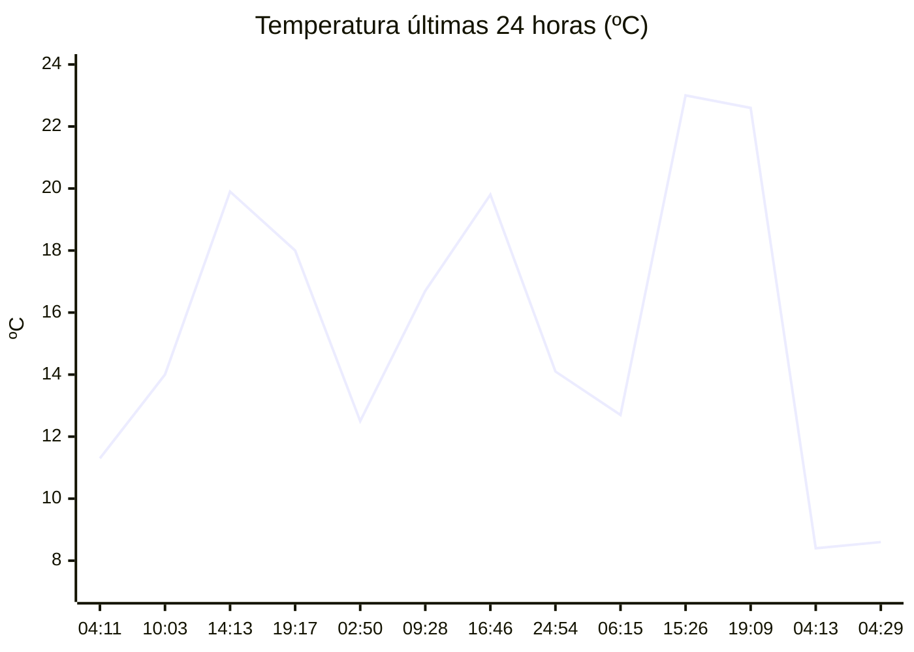

# rem-scrap

Actualización automática del clima para la estación Concarán.

## Últimos datos

| Campo | Valor |
| --- | --- |
| Estación | Concarán |
| Hora | 04:28 |
| Temperatura | 8,6 ºC |
| Humedad | 99,8 % |
| Lluvia (1h) | 0,0 mm |
| Lluvia (24h) | 0,0 mm |
| Lluvia (30d) | 36,0 mm |
| Lluvia (Año) | 548,1 mm |
| Rad. Solar | 0,0 W/m2 |
| Temp Max Hoy | 11 ºC a las 00:01 |
| Temp Min Hoy | 9 ºC a las 03:57 |
| VPS (VPD) | 0 kPa (bajo) |

## Resumen IA

Estación Concarán, 04:28 h: madrugada fría y extremadamente húmeda. La temperatura actual es 8,6 ºC, comparada con la máxima de 11 ºC y la mínima registrada de 9 ºC; el rango térmico del día es de 2 ºC y el valor presente se sitúa por debajo del mínimo oficial, indicando un ligero descenso nocturno. La humedad relativa está al 99,8 %, casi la saturación, y el VPD es 0 kPa, lo que implica una atmósfera con mínima demanda de transpiración y un riesgo alto de desarrollo de hongos por humedad estancada. No se registró lluvia en la última hora ni en las últimas 24 h; sin embargo, en los últimos 30 d se acumularon 36,0 mm y en el año 548,1 mm, mostrando un contexto pluviométrico significativo. La radiación solar es 0 W/m2, acorde a la hora nocturna, por lo que no hay aporte de energía solar. Recomendación: ventilar el cultivo y, si es posible, aplicar medidas preventivas contra enfermedades fúngicas.

## Tendencia últimas 24 h

## Fuente

Datos extraídos de [clima.sanluis.gob.ar](https://clima.sanluis.gob.ar/Estacion.aspx?estacion=8).

## Generado automáticamente

Este archivo fue actualizado el 21 de octubre de 2026 a las 07:29:49.
