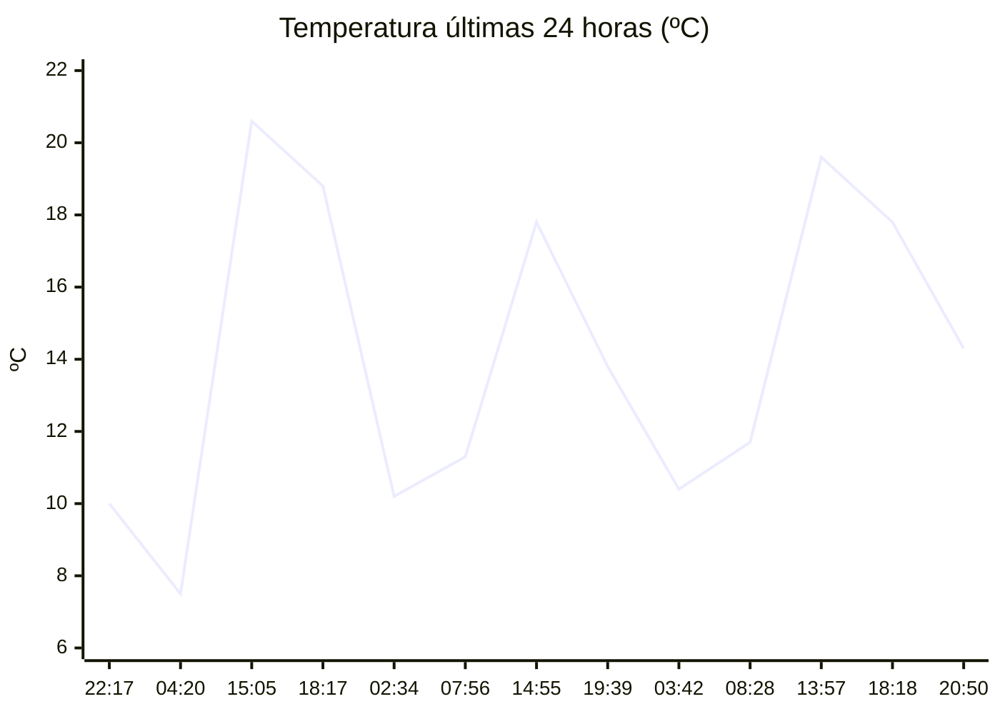

# rem-scrap

Actualización automática del clima para la estación Concarán.

## Últimos datos

| Campo | Valor |
| --- | --- |
| Estación | Concarán |
| Hora | 20:49 |
| Temperatura | 14,3 ºC |
| Humedad | 81,4 % |
| Lluvia (1h) | 0,0 mm |
| Lluvia (24h) | 0,0 mm |
| Lluvia (30d) | 36,0 mm |
| Lluvia (Año) | 548,1 mm |
| Rad. Solar | 0,0 W/m2 |
| Temp Max Hoy | 22 ºC a las 14:39 |
| Temp Min Hoy | 9 ºC a las 05:44 |
| VPS (VPD) | 0.3 kPa (bajo) |

## Resumen IA

Estación Concarán, 20:49 h – la tarde se tornó fresca y bastante húmeda.  
Temperatura actual 14,3 ºC, dentro del rango del día (9 ºC – 22 ºC) con una amplitud de 13 ºC. La medida está 5,3 ºC por encima del mínimo y 7,7 ºC por debajo del máximo, por lo que se acerca más al extremo frío del día.  
Humedad relativa 81,4 % y VPD 0,3 kPa. Ese VPD bajo indica aire poco demandante, con transpiración limitada y condiciones propicias para el desarrollo de hongos si el follaje permanece húmedo. Para las plantas, la disponibilidad de agua es alta y el estrés hídrico es nulo.  
No se registró lluvia en la última hora ni en las últimas 24 h; la radiación solar es 0 W/m2, típica de la noche. La ausencia de precipitación reciente no altera la humedad del aire, que ya es elevada.  
Recomendación: vigilar la ventilación nocturna para evitar la proliferación de enfermedades fúngicas en cultivos sensibles.

## Tendencia últimas 24 h

## Fuente

Datos extraídos de [clima.sanluis.gob.ar](https://clima.sanluis.gob.ar/Estacion.aspx?estacion=8).

## Generado automáticamente

Este archivo fue actualizado el 17 de octubre de 2026 a las 11:50:33.
