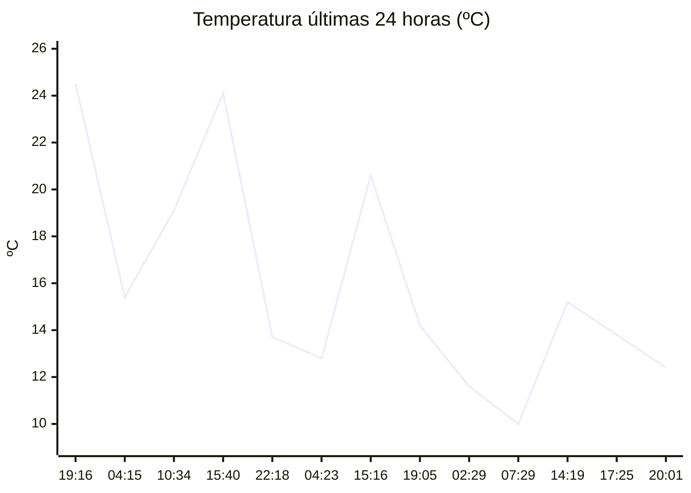

# rem-scrap

Actualización automática del clima para la estación Concarán.

## Últimos datos

| Campo | Valor |
| --- | --- |
| Estación | Concarán |
| Hora | 20:00 |
| Temperatura | 12,4 ºC |
| Humedad | 70,4 % |
| Lluvia (1h) | 0,0 mm |
| Lluvia (24h) | 2,1 mm |
| Lluvia (30d) | 42,8 mm |
| Lluvia (Año) | 554,8 mm |
| Rad. Solar | 0,0 W/m2 |
| Temp Max Hoy | 17 ºC a las 11:53 |
| Temp Min Hoy | 9 ºC a las 06:14 |
| VPS (VPD) | 0.43 kPa (bajo) |

## Resumen IA

Estación Concarán, 20:00 – la noche se presenta fresca y bastante húmeda.  

Temperatura actual 12,4 ºC está dentro del rango térmico del día (9 ºC – 17 ºC, rango 8 ºC) y se sitúa más cerca del mínimo diario (a 3,4 ºC) que de la máxima (a 4,6 ºC).  

La humedad relativa es 70,4 % y el VPD es 0,43 kPa, claramente bajo el umbral de 0,8 kPa. Esto indica que el aire tiene baja demanda de vapor, favoreciendo la transpiración reducida y aumentando el riesgo de desarrollo de hongos por humedad estancada, condición que favorece a cultivos que requieren buen drenaje.  

En la última hora no cayó lluvia, pero en las últimas 24 h se registraron 2,1 mm, lo que ha contribuido a la humedad alta del ambiente. La radiación solar es nula a esta hora, por lo que no hay aporte de energía solar.  

Recomendación: ventilar el invernadero o cultivo al menos una vez al día para reducir la humedad y prevenir enfermedades fúngicas.

## Tendencia últimas 24 h

## Fuente

Datos extraídos de [clima.sanluis.gob.ar](https://clima.sanluis.gob.ar/Estacion.aspx?estacion=8).

## Generado automáticamente

Este archivo fue actualizado el 24 de octubre de 2026 a las 11:01:51.
