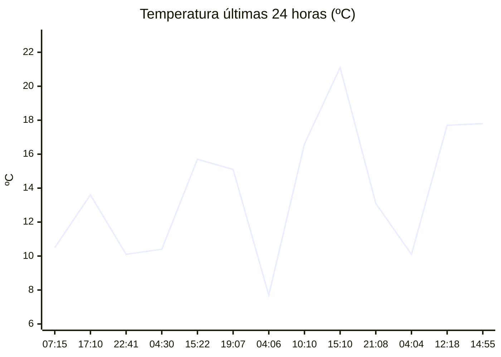

# rem-scrap

Actualización automática del clima para la estación Concarán.

## Últimos datos

| Campo | Valor |
| --- | --- |
| Estación | Concarán |
| Hora | 14:54 |
| Temperatura | 17,8 ºC |
| Humedad | 58,1 % |
| Lluvia (1h) | 0,0 mm |
| Lluvia (24h) | 4,4 mm |
| Lluvia (30d) | 32,9 mm |
| Lluvia (Año) | 544,9 mm |
| Rad. Solar | 58,0 W/m2 |
| Temp Max Hoy | 19 ºC a las 13:08 |
| Temp Min Hoy | 9 ºC a las 06:20 |
| VPS (VPD) | 0.85 kPa (ideal) |

## Resumen IA

Estación Concarán, 14:54 h – tarde templada y ligeramente nublada, con el ambiente estable.  
Temperatura actual 17,8 ºC está a 1,2 ºC del máximo alcanzado hoy (19 ºC a 13:08) y a 8,8 ºC del mínimo (9 ºC a 06:20). El rango térmico del día es de 10 ºC; la temperatura del momento se sitúa mucho más cerca del extremo máximo, indicando que el calor del mediodía aún persiste.  
Humedad relativa 58,1 % acompañada de un VPD de 0,85 kPa, valor catalogado como ideal (entre 0,8 y 1,2 kPa). El aire presenta una demanda de agua moderada, favorable para la transpiración vegetativa y sin riesgo inmediato de estrés hídrico ni de desarrollo de hongos por exceso de humedad.  
En la última hora no cayó lluvia (0,0 mm), pero en las últimas 24 h se registraron 4,4 mm, lo que eleva ligeramente la humedad del suelo. La radiación solar de 58 W/m² a esta hora sugiere cobertura nubosa y baja intensidad lumínica.  
Recomendación: mantenga riegos ligeros y evite exceso de humedad; ventile si el cielo se despeja para prevenir acumulación de humedad en el follaje.

## Tendencia últimas 24 h

## Fuente

Datos extraídos de [clima.sanluis.gob.ar](https://clima.sanluis.gob.ar/Estacion.aspx?estacion=8).

## Generado automáticamente

Este archivo fue actualizado el 16 de octubre de 2026 a las 05:55:38.
