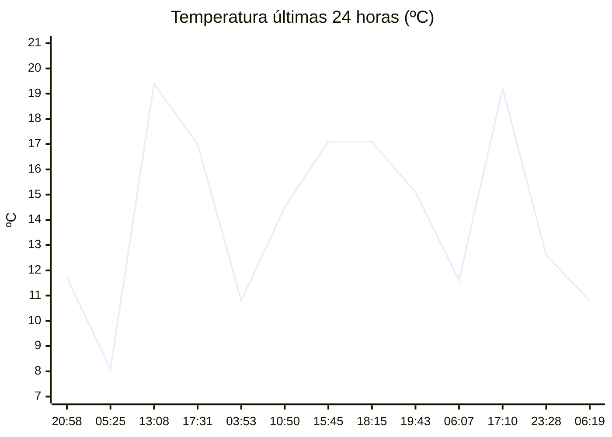

# rem-scrap

Actualización automática del clima para la estación Concarán.

## Últimos datos

| Campo | Valor |
| --- | --- |
| Estación | Concarán |
| Hora | 06:18 |
| Temperatura | 10,8 ºC |
| Humedad | 99,8 % |
| Lluvia (1h) | 0,0 mm |
| Lluvia (24h) | 2,1 mm |
| Lluvia (30d) | 25,7 mm |
| Lluvia (Año) | 537,6 mm |
| Rad. Solar | 0,0 W/m2 |
| Temp Max Hoy | 13 ºC a las 01:04 |
| Temp Min Hoy | 9 ºC a las 05:54 |
| VPS (VPD) | 0 kPa (bajo) |

## Resumen IA

Estación Concarán, 06:18. La madrugada se presenta fresca y extremadamente húmeda.  

Temperatura actual 10,8 ºC, dentro del rango del día de 9 ºC a 13 ºC (rango térmico = 4 ºC). El valor actual está más próximo al mínimo (9 ºC) que al máximo (13 ºC), indicando que aún no se ha alcanzado el pico térmico del día.  

Humedad relativa 99,8 % y VPD 0 kPa. Un VPD nulo significa que el aire está poco demandante; la transpiración de las plantas será mínima pero el riesgo de desarrollo de hongos aumenta por la humedad estancada.  

Lluvia en la última hora 0,0 mm, pero 2,1 mm en las últimas 24 h, lo que contribuye a la humedad casi saturada del ambiente. Radiación solar 0 W/m2, típica de la hora temprana antes del amanecer, sin aporte de energía solar.  

Recomendación: aplicar ventilación ligera o abrir coberturas para reducir la humedad y prevenir enfermedades fúngicas.

## Tendencia últimas 24 h

## Fuente

Datos extraídos de [clima.sanluis.gob.ar](https://clima.sanluis.gob.ar/Estacion.aspx?estacion=8).

## Generado automáticamente

Este archivo fue actualizado el 13 de octubre de 2026 a las 09:19:44.
