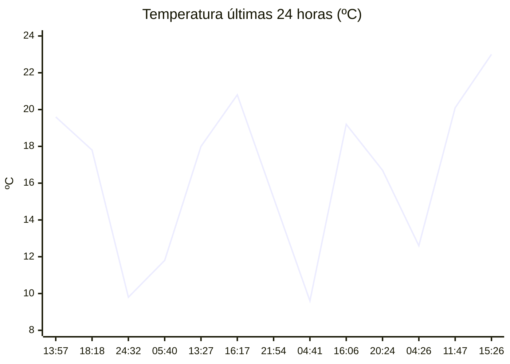

# rem-scrap

Actualización automática del clima para la estación Concarán.

## Últimos datos

| Campo | Valor |
| --- | --- |
| Estación | Concarán |
| Hora | 15:25 |
| Temperatura | 23,0 ºC |
| Humedad | 40,4 % |
| Lluvia (1h) | 0,0 mm |
| Lluvia (24h) | 0,0 mm |
| Lluvia (30d) | 36,0 mm |
| Lluvia (Año) | 548,1 mm |
| Rad. Solar | 233,0 W/m2 |
| Temp Max Hoy | 23 ºC a las 14:52 |
| Temp Min Hoy | 12 ºC a las 03:35 |
| VPS (VPD) | 1.67 kPa (alto) |

## Resumen IA

Concarán, 15:25 – la tarde se presenta cálida y bastante seca. La temperatura actual es 23,0 ºC, idéntica a la máxima de hoy (23 ºC a 14:52) y alejada de la mínima de 12 ºC alcanzada a las 03:35, lo que genera un rango térmico de 11 ºC; el ambiente está prácticamente en el extremo superior del día. La humedad relativa es 40,4 % y el VPD registra 1,67 kPa, un valor alto que indica aire muy seco y una fuerte demanda de transpiración, lo que puede producir estrés hídrico en cultivos sensibles. No se registró lluvia en la última hora ni en las últimas 24 h; el acumulado mensual es 36,0 mm y el anual 548,1 mm, por lo que el suelo sigue sin aportes recientes de agua. La radiación solar de 233 W/m2 a esta hora es moderada‑alta, reforzando la evaporación y el calentamiento. Se recomienda aplicar riego de cobertura y, si es posible, proveer sombra ligera o ventilación para aliviar el estrés hídrico de las plantas.

## Tendencia últimas 24 h

## Fuente

Datos extraídos de [clima.sanluis.gob.ar](https://clima.sanluis.gob.ar/Estacion.aspx?estacion=8).

## Generado automáticamente

Este archivo fue actualizado el 20 de octubre de 2026 a las 06:26:16.
