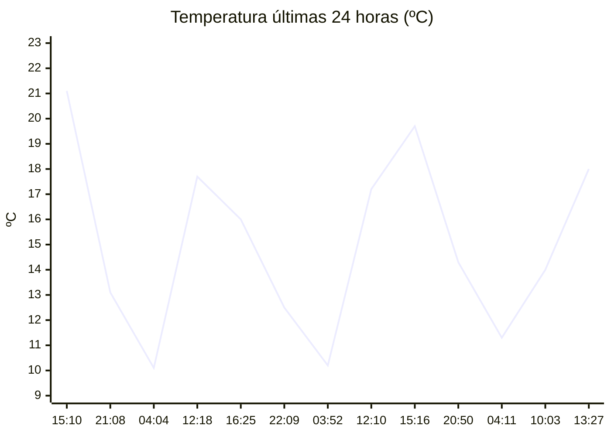

# rem-scrap

Actualización automática del clima para la estación Concarán.

## Últimos datos

| Campo | Valor |
| --- | --- |
| Estación | Concarán |
| Hora | 13:26 |
| Temperatura | 18,0 ºC |
| Humedad | 56,1 % |
| Lluvia (1h) | 0,0 mm |
| Lluvia (24h) | 0,0 mm |
| Lluvia (30d) | 36,0 mm |
| Lluvia (Año) | 548,1 mm |
| Rad. Solar | 242,0 W/m2 |
| Temp Max Hoy | 19 ºC a las 12:57 |
| Temp Min Hoy | 10 ºC a las 00:36 |
| VPS (VPD) | 0.91 kPa (ideal) |

## Resumen IA

Estación Concarán, 13:26 – se presenta una tarde templada y algo soleada. La temperatura actual de 18,0 ºC está a 1 °C de la máxima de 19 ºC registrada a las 12:57 y a 8 °C de la mínima de 10 ºC de la madrugada, lo que indica que el clima se encuentra próximo al extremo más cálido del día; el rango térmico del día es de 9 ºC. La humedad relativa es de 56,1 %, un nivel medio que, junto al VPD de 0,91 kPa (valor ideal), sugiere que el aire no está ni demasiado seco ni saturado, proporcionando condiciones cómodas para la transpiración y favoreciendo el desarrollo vegetativo sin riesgo significativo de estrés hídrico o de hongos. No se registró lluvia en la última hora ni en las últimas 24 h, por lo que la humedad del aire proviene exclusivamente de la evapotranspiración; la radiación solar de 242 W/m2 a esa hora indica una intensidad solar moderada‑alta, suficiente para una buena fotosíntesis. Mantener el riego programado y ventilar ligeramente el cultivo permitirá aprovechar la luz sin incurrir en déficit hídrico.

## Tendencia últimas 24 h

## Fuente

Datos extraídos de [clima.sanluis.gob.ar](https://clima.sanluis.gob.ar/Estacion.aspx?estacion=8).

## Generado automáticamente

Este archivo fue actualizado el 18 de octubre de 2026 a las 04:27:44.
