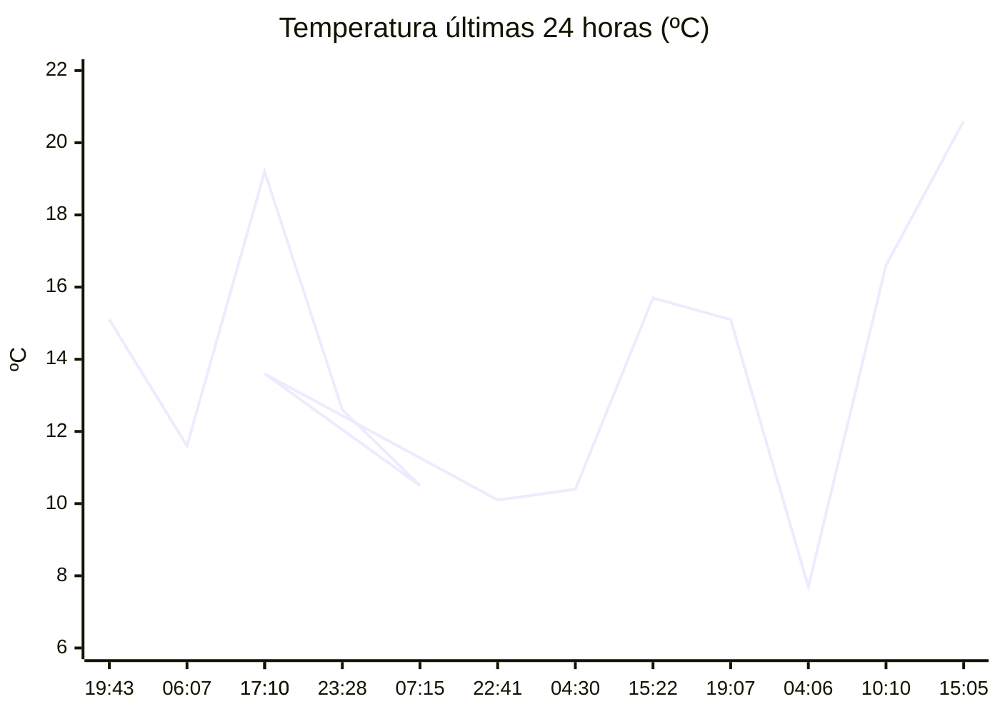

# rem-scrap

Actualización automática del clima para la estación Concarán.

## Últimos datos

| Campo | Valor |
| --- | --- |
| Estación | Concarán |
| Hora | 15:04 |
| Temperatura | 20,6 ºC |
| Humedad | 39,2 % |
| Lluvia (1h) | 0,0 mm |
| Lluvia (24h) | 0,0 mm |
| Lluvia (30d) | 28,5 mm |
| Lluvia (Año) | 540,5 mm |
| Rad. Solar | 754,0 W/m2 |
| Temp Max Hoy | 21 ºC a las 14:15 |
| Temp Min Hoy | 5 ºC a las 06:14 |
| VPS (VPD) | 1.48 kPa (alto) |

## Resumen IA

Estación Concarán, 15:04 h – tarde cálida y seca, con sol fuerte y suelo aún sin lluvias recientes.  

Temperatura actual 20,6 ºC está muy próxima al máximo del día (21 ºC a las 14:15) y lejos de la mínima (5 ºC a las 06:14). El rango térmico del día es de 16 ºC; la medida actual se sitúa apenas 0,4 ºC bajo el pico máximo, indicando que el ambiente está en la fase caliente del día.  

Humedad relativa 39,2 % combinada con VPD 1.48 kPa se ubica en el rango entre 1.2 y 1.5 kPa, lo que implica aire seco y una demanda de transpiración alta para las plantas; el riesgo de estrés hídrico es notable y la evaporación será acelerada.  

No hubo precipitación en la última hora ni en las últimas 24 h; la falta de lluvia mantiene la humedad del aire baja. La radiación solar de 754 W/m² a media tarde indica una exposición solar intensa, favoreciendo el calentamiento del follaje y la evaporación del suelo.  

Recomendación: aplicar riego ligero y puntual y ventilar el cultivo para aliviar el estrés por déficit hídrico.

## Tendencia últimas 24 h

## Fuente

Datos extraídos de [clima.sanluis.gob.ar](https://clima.sanluis.gob.ar/Estacion.aspx?estacion=8).

## Generado automáticamente

Este archivo fue actualizado el 15 de octubre de 2026 a las 06:05:28.
