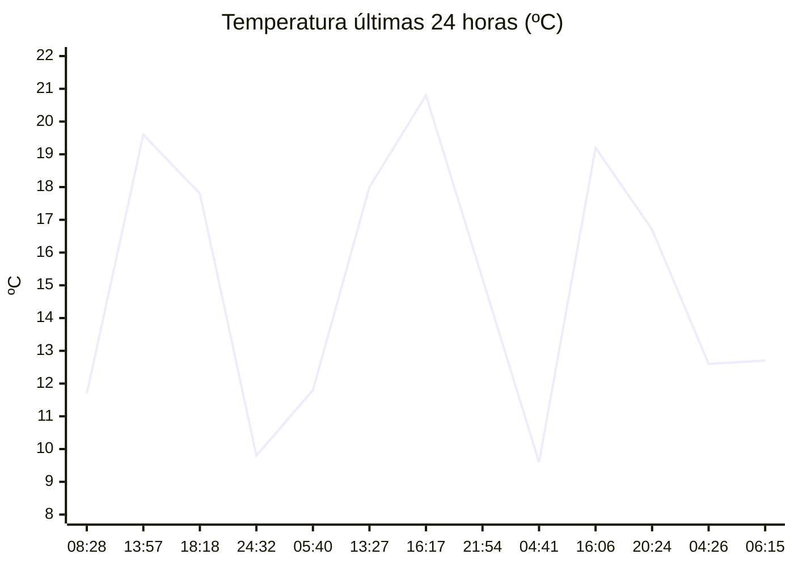

# rem-scrap

Actualización automática del clima para la estación Concarán.

## Últimos datos

| Campo | Valor |
| --- | --- |
| Estación | Concarán |
| Hora | 06:14 |
| Temperatura | 12,7 ºC |
| Humedad | 99,3 % |
| Lluvia (1h) | 0,0 mm |
| Lluvia (24h) | 0,0 mm |
| Lluvia (30d) | 36,0 mm |
| Lluvia (Año) | 548,1 mm |
| Rad. Solar | 0,0 W/m2 |
| Temp Max Hoy | 16 ºC a las 00:02 |
| Temp Min Hoy | 12 ºC a las 03:35 |
| VPS (VPD) | 0.01 kPa (bajo) |

## Resumen IA

Estación Concarán, 06:14 – la mañana se presenta fresca y muy húmeda, con cielo nublado y sin sol directo.  
Temperatura: 12,7 ºC, frente a la máxima de 16 ºC y la mínima de 12 ºC del día. El rango térmico del día es de 4 ºC; la temperatura actual está a 0,7 ºC de la mínima y a 3,3 ºC de la máxima, por lo que se acerca mucho más al extremo frío.  
Humedad y vapor: la humedad relativa es 99,3 % y el VPD es 0,01 kPa, valor muy bajo (<0,8 kPa). El aire está poco demandante, favoreciendo la transpiración reducida y aumentando el riesgo de desarrollo de hongos por la humedad estancada.  
Lluvia y radiación: no se registró precipitación en la última hora ni en las últimas 24 h; la radiación solar es 0 W/m2, típica de la madrugada antes del albor.  
Recomendación: mantenga buena ventilación del cultivo y vigile signos de enfermedad fúngica, evitando el exceso de riego en este ambiente saturado.

## Tendencia últimas 24 h

## Fuente

Datos extraídos de [clima.sanluis.gob.ar](https://clima.sanluis.gob.ar/Estacion.aspx?estacion=8).

## Generado automáticamente

Este archivo fue actualizado el 20 de octubre de 2026 a las 09:15:55.
