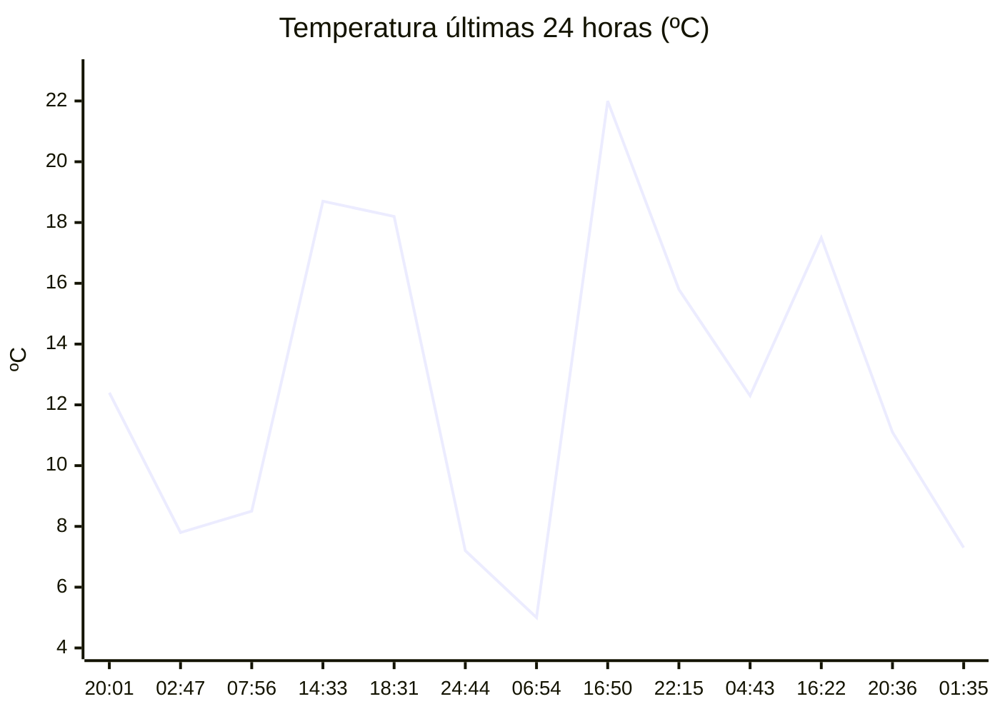

# rem-scrap

Actualización automática del clima para la estación Concarán.

## Últimos datos

| Campo | Valor |
| --- | --- |
| Estación | Concarán |
| Hora | 01:34 |
| Temperatura | 7,3 ºC |
| Humedad | 99,8 % |
| Lluvia (1h) | 0,0 mm |
| Lluvia (24h) | 0,7 mm |
| Lluvia (30d) | 42,9 mm |
| Lluvia (Año) | 555,5 mm |
| Rad. Solar | 0,0 W/m2 |
| Temp Max Hoy | 8 ºC a las 00:07 |
| Temp Min Hoy | 7 ºC a las 00:54 |
| VPS (VPD) | 0 kPa (bajo) |

## Resumen IA

Estación Concarán, 01:34 – madrugada fría y extremadamente húmeda.  
Temperatura actual 7,3 ºC, con una máxima de 8 ºC (00:07) y una mínima de 7 ºC (00:54). El rango térmico del día es de 1 ºC; el valor presente se sitúa 0,3 ºC por encima del mínimo y 0,7 ºC por debajo del máximo, por lo que está más próximo al extremo mínimo.  
Humedad relativa 99,8 % y VPD 0 kPa (valor bajo). Un VPD por debajo de 0,8 kPa indica aire poco demandante, con transpiración muy reducida y alta probabilidad de desarrollo de hongos por humedad estancada; las plantas perciben un ambiente casi saturado.  
Lluvia en la última hora 0,0 mm, pero en las últimas 24 h cayó 0,7 mm, manteniendo la humedad del suelo y del aire elevada. La radiación solar es 0 W/m2, típica de la noche.  
Recomendación: aplicar ventilación ligera o aireación nocturna y evitar riegos adicionales para prevenir enfermedades fúngicas en el cultivo.

## Tendencia últimas 24 h

## Fuente

Datos extraídos de [clima.sanluis.gob.ar](https://clima.sanluis.gob.ar/Estacion.aspx?estacion=8).

## Generado automáticamente

Este archivo fue actualizado el 28 de octubre de 2026 a las 04:35:42.
