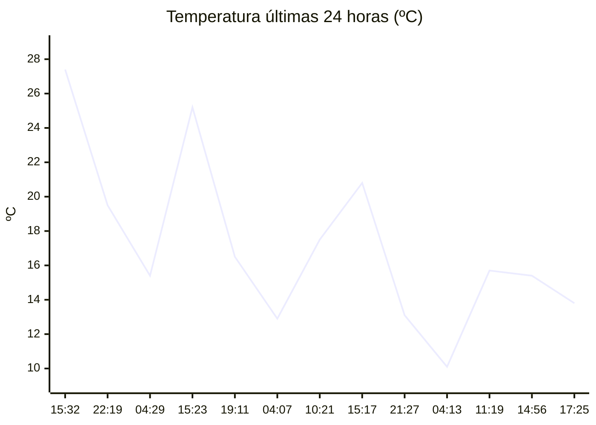

# rem-scrap

Actualización automática del clima para la estación Concarán.

## Últimos datos

| Campo | Valor |
| --- | --- |
| Estación | Concarán |
| Hora | 17:24 |
| Temperatura | 13,8 ºC |
| Humedad | 62,3 % |
| Lluvia (1h) | 0,0 mm |
| Lluvia (24h) | 2,1 mm |
| Lluvia (30d) | 42,8 mm |
| Lluvia (Año) | 554,8 mm |
| Rad. Solar | 121,0 W/m2 |
| Temp Max Hoy | 17 ºC a las 11:53 |
| Temp Min Hoy | 9 ºC a las 06:14 |
| VPS (VPD) | 0.59 kPa (bajo) |

## Resumen IA

Estación Concarán, 17:24 – tarde fresca y húmeda, con cielo parcialmente nublado. La temperatura actual de 13,8 ºC se sitúa entre la máxima de 17 ºC y la mínima de 9 ºC; el rango térmico del día es de 8 ºC y el valor presente está 3,2 ºC por debajo del pico y 4,8 ºC por encima del valle, acercándose más a la máxima. La humedad relativa es de 62,3 % y el VPD (vps) registra 0,59 kPa, valor bajo que indica aire poco demandante, transpiración reducida y mayor propensión a la aparición de hongos si el follaje permanece húmedo. En la última hora no hubo precipitación, pero en las últimas 24 h cayó 2,1 mm, lo que contribuye a la humedad del suelo y del aire. La radiación solar de 121 W/m2 a esta hora del día representa una intensidad moderada, sin llegar al máximo del mediodía. Mantener una buena ventilación y evitar riegos intensos ahora que el VPD es bajo para prevenir problemas fúngicos.

## Tendencia últimas 24 h

## Fuente

Datos extraídos de [clima.sanluis.gob.ar](https://clima.sanluis.gob.ar/Estacion.aspx?estacion=8).

## Generado automáticamente

Este archivo fue actualizado el 24 de octubre de 2026 a las 08:25:32.
