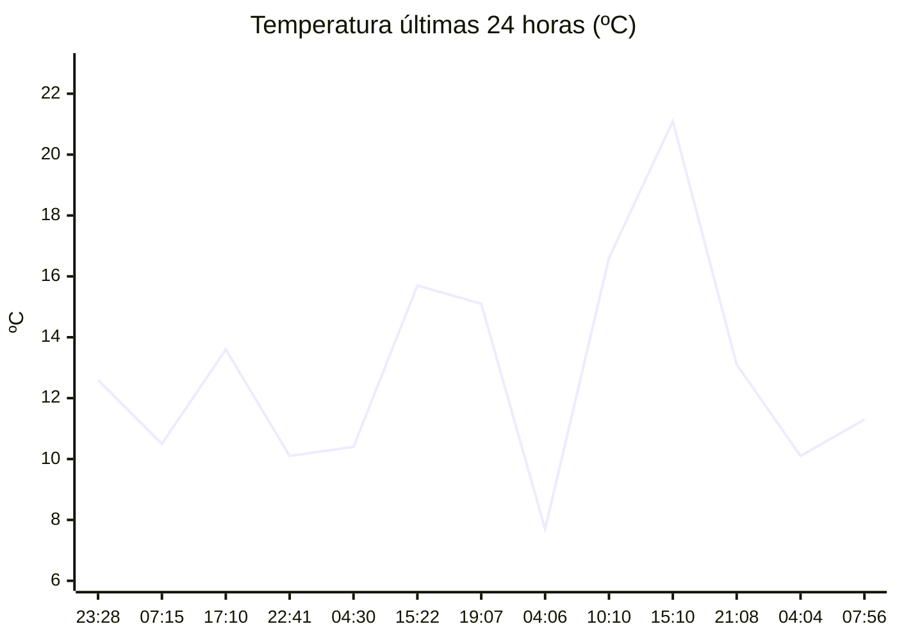

# rem-scrap

Actualización automática del clima para la estación Concarán.

## Últimos datos

| Campo | Valor |
| --- | --- |
| Estación | Concarán |
| Hora | 07:55 |
| Temperatura | 11,3 ºC |
| Humedad | 99,8 % |
| Lluvia (1h) | 0,0 mm |
| Lluvia (24h) | 1,4 mm |
| Lluvia (30d) | 29,9 mm |
| Lluvia (Año) | 541,9 mm |
| Rad. Solar | 84,0 W/m2 |
| Temp Max Hoy | 12 ºC a las 01:13 |
| Temp Min Hoy | 9 ºC a las 06:20 |
| VPS (VPD) | 0 kPa (bajo) |

## Resumen IA

Estación Concarán, 07:55 h – mañana fresca y extremadamente húmeda, con cielo parcialmente nublado.  

Temperatura actual 11,3 ºC, frente a la máxima de 12 ºC registrada a la 01:13 y la mínima de 9 ºC a las 06:20; el rango térmico del día es de 3 ºC. El valor de 11,3 ºC está a solo 0,7 ºC de la máxima y 2,3 ºC de la mínima, por lo que se acerca más al extremo cálido del día.  

Humedad relativa 99,8 % y VPD (vps) 0 kPa. Con un VPD por debajo de 0,8 kPa el aire es poco demandante: la transpiración de las plantas es mínima y el riesgo de desarrollo de hongos por humedad estancada es alto.  

No hubo precipitación en la última hora, pero sí 1,4 mm en las últimas 24 h, lo que alimenta la humedad del suelo y del aire. La radiación solar de 84 W/m2 es tenue para la mañana, indicando poca energía luminosa disponible.  

Recomendación: ventilar los cultivos para reducir la humedad y prevenir enfermedades; posponer riegos hasta que el follaje esté más seco.

## Tendencia últimas 24 h

## Fuente

Datos extraídos de [clima.sanluis.gob.ar](https://clima.sanluis.gob.ar/Estacion.aspx?estacion=8).

## Generado automáticamente

Este archivo fue actualizado el 16 de octubre de 2026 a las 10:56:37.
