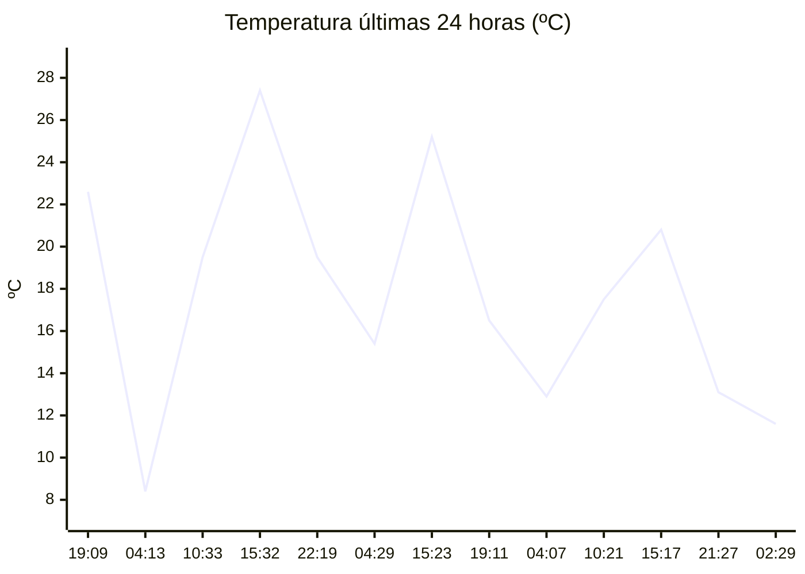

# rem-scrap

Actualización automática del clima para la estación Concarán.

## Últimos datos

| Campo | Valor |
| --- | --- |
| Estación | Concarán |
| Hora | 02:28 |
| Temperatura | 11,6 ºC |
| Humedad | 90,3 % |
| Lluvia (1h) | 0,0 mm |
| Lluvia (24h) | 0,0 mm |
| Lluvia (30d) | 40,6 mm |
| Lluvia (Año) | 552,6 mm |
| Rad. Solar | 0,0 W/m2 |
| Temp Max Hoy | 12 ºC a las 00:01 |
| Temp Min Hoy | 11 ºC a las 00:54 |
| VPS (VPD) | 0.13 kPa (bajo) |

## Resumen IA

Estación Concarán, 02:28 h – noche fresca y muy húmeda. La temperatura actual de 11,6 ºC se sitúa dentro del estrecho rango del día (máx 12 ºC, mín 11 ºC); está a 0,4 ºC de la máxima y a 0,6 ºC de la mínima, por lo que se acerca más al extremo más cálido. La humedad relativa es del 90,3 % y el VPD registrado es 0,13 kPa, claramente bajo el umbral de 0,8 kPa que indica aire poco demandante: la transpiración de las plantas será mínima y el riesgo de desarrollo de hongos aumenta por la humedad estancada. No se registró precipitación en la última hora ni en las últimas 24 h, pese a los 40,6 mm acumulados en los últimos 30 días y 552,6 mm en el año. La radiación solar es nula, acorde a la hora nocturna, por lo que no hay aporte de energía solar. Recomendación: mantenga la ventilación del cultivo durante la madrugada para reducir la humedad y evitar problemas fúngicos.

## Tendencia últimas 24 h

## Fuente

Datos extraídos de [clima.sanluis.gob.ar](https://clima.sanluis.gob.ar/Estacion.aspx?estacion=8).

## Generado automáticamente

Este archivo fue actualizado el 24 de octubre de 2026 a las 05:29:35.
