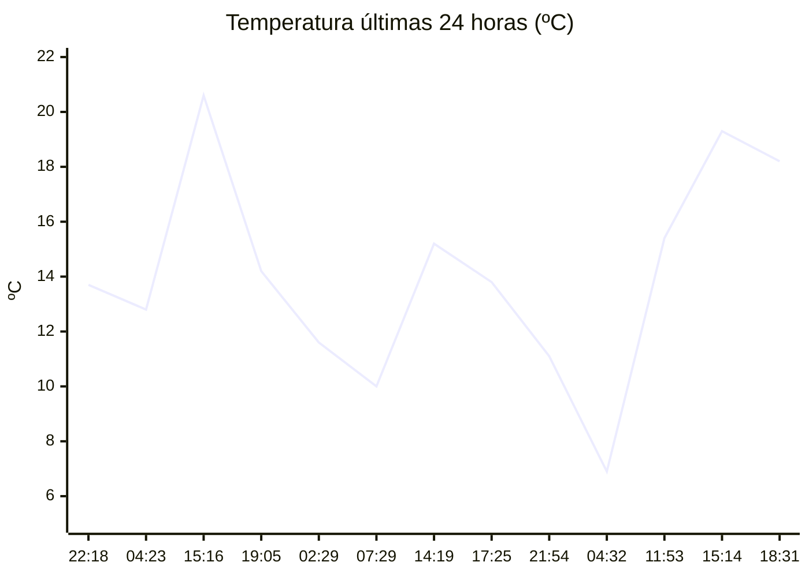

# rem-scrap

Actualización automática del clima para la estación Concarán.

## Últimos datos

| Campo | Valor |
| --- | --- |
| Estación | Concarán |
| Hora | 18:30 |
| Temperatura | 18,2 ºC |
| Humedad | 40,5 % |
| Lluvia (1h) | 0,0 mm |
| Lluvia (24h) | 0,0 mm |
| Lluvia (30d) | 42,8 mm |
| Lluvia (Año) | 554,8 mm |
| Rad. Solar | 50,0 W/m2 |
| Temp Max Hoy | 20 ºC a las 16:28 |
| Temp Min Hoy | 7 ºC a las 04:22 |
| VPS (VPD) | 1.24 kPa (alto) |

## Resumen IA

Concarán, 18:30 h – tarde fresca y algo seca.  
Temperatura actual 18,2 ºC, con una máxima de 20 ºC y una mínima de 7 ºC; el rango térmico del día es de 13 ºC. El valor actual está a solo 1,8 ºC de la máxima y a 11,2 ºC de la mínima, por lo que se aproxima al extremo cálido del día.  
La humedad relativa es 40,5 % y el VPD (vps) registra 1,24 kPa, considerado “alto”. Un VPD entre 0,8 y 1,2 kPa es ideal para el crecimiento vegetativo; 1,24 kPa indica una demanda de vapor ligeramente superior al óptimo, lo que puede generar un leve estrés hídrico y reduce la transpiración eficiente de las plantas.  
No hubo lluvia en la última hora ni en las últimas 24 h; la falta de precipitación mantiene la humedad del aire baja. La radiación solar es de 50 W/m2, valor típico de un atardecer, insuficiente para un calentamiento significativo.  
Recomendación: vigilar el riego y, si el cultivo es sensible, aplicar una ligera humedad al sustrato para evitar estrés hídrico.

## Tendencia últimas 24 h

## Fuente

Datos extraídos de [clima.sanluis.gob.ar](https://clima.sanluis.gob.ar/Estacion.aspx?estacion=8).

## Generado automáticamente

Este archivo fue actualizado el 25 de octubre de 2026 a las 09:31:26.
