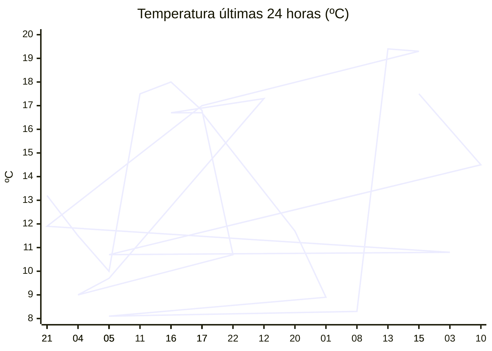

# rem-scrap

Actualización automática del clima para la estación Concarán.

## Últimos datos

| Campo | Valor |
| --- | --- |
| Estación | Concarán |
| Hora | 15:40 |
| Temperatura | 17,5 ºC |
| Humedad | 59,8 % |
| Lluvia (1h) | 0,0 mm |
| Lluvia (24h) | 0,0 mm |
| Lluvia (30d) | 36,8 mm |
| Lluvia (Año) | 534,2 mm |
| Rad. Solar | 244,0 W/m2 |
| Temp Max Hoy | 18 ºC a las 13:24 |
| Temp Min Hoy | 10 ºC a las 07:01 |
| VPS (VPD) | 0.8 kPa (ideal) |

## Resumen IA

Concarán, 15:40 – tarde templada y ligeramente húmeda. La temperatura actual es 17,5 ºC, apenas 0,5 ºC por debajo de la máxima del día (18 ºC) y a 7,5 ºC de la mínima (10 ºC). El rango térmico del día es de 8 ºC, y el momento se sitúa muy próximo al extremo cálido. La humedad relativa es 59,8 % y el VPD reportado es 0,8 kPa, valor catalogado como ideal para el desarrollo vegetativo: el aire ofrece suficiente capacidad de absorción sin generar estrés hídrico ni favorecer la proliferación de hongos. No se registró lluvia en la última hora ni en las últimas 24 h, por lo que la humedad percibida proviene del vapor atmosférico y no de precipitaciones recientes. La radiación solar de 244 W/m2 a esta hora indica una intensidad solar moderada‑alta, suficiente para una buena fotosíntesis. Recomendación: mantener riego moderado y, si el cultivo lo permite, abrir ventilación ligera para aprovechar la buena luz sin riesgo de desecación.

## Tendencia últimas 24 h

## Fuente

Datos extraídos de [clima.sanluis.gob.ar](https://clima.sanluis.gob.ar/Estacion.aspx?estacion=8).

## Generado automáticamente

Este archivo fue actualizado el 11 de octubre de 2026 a las 06:41:17.
