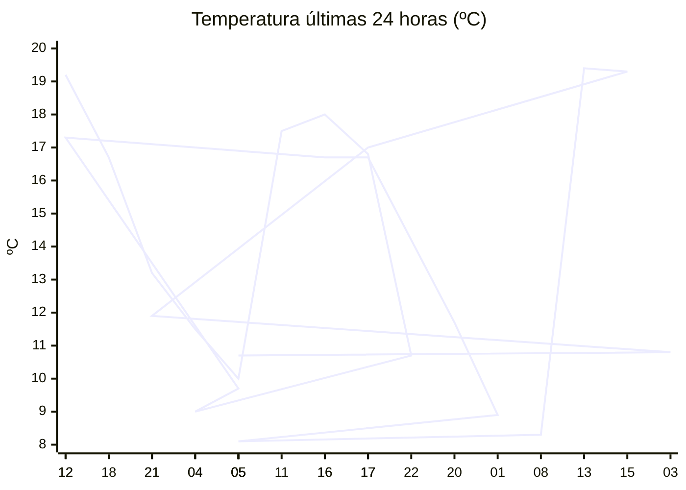

# rem-scrap

Actualización automática del clima para la estación Concarán.

## Últimos datos

| Campo | Valor |
| --- | --- |
| Estación | Concarán |
| Hora | 05:42 |
| Temperatura | 10,7 ºC |
| Humedad | 99,7 % |
| Lluvia (1h) | 0,0 mm |
| Lluvia (24h) | 0,3 mm |
| Lluvia (30d) | 36,8 mm |
| Lluvia (Año) | 534,2 mm |
| Rad. Solar | 0,0 W/m2 |
| Temp Max Hoy | 11 ºC a las 00:50 |
| Temp Min Hoy | 11 ºC a las 04:34 |
| VPS (VPD) | 0 kPa (bajo) |

## Resumen IA

Estación Concarán, 05:42 – madrugada fresca y extremadamente húmeda.  

Temperatura actual 10,7 ºC, ligeramente por debajo del máximo de 11 ºC y de la mínima de 11 ºC registrados hoy; el rango térmico del día es prácticamente nulo (0 ºC) y la medida actual se ubica a 0,3 ºC del extremo superior, casi en el nivel más bajo del día.  

La humedad relativa es de 99,7 % y el VPD (vps) indica 0 kPa, lo que revela aire saturado, mínima demanda de transpiración y alto riesgo de desarrollo de hongos en el follaje.  

No hubo lluvia en la última hora, pero el registro de 0,3 mm en las últimas 24 h mantiene la superficie del suelo húmeda, reforzando la humedad del aire. La radiación solar es 0,0 W/m2, coherente con la oscuridad del momento.  

Recomendación: ventilar ligeramente el cultivo y evitar riegos adicionales hasta que la humedad del aire disminuya.

## Tendencia últimas 24 h

## Fuente

Datos extraídos de [clima.sanluis.gob.ar](https://clima.sanluis.gob.ar/Estacion.aspx?estacion=8).

## Generado automáticamente

Este archivo fue actualizado el 11 de octubre de 2026 a las 08:43:03.
