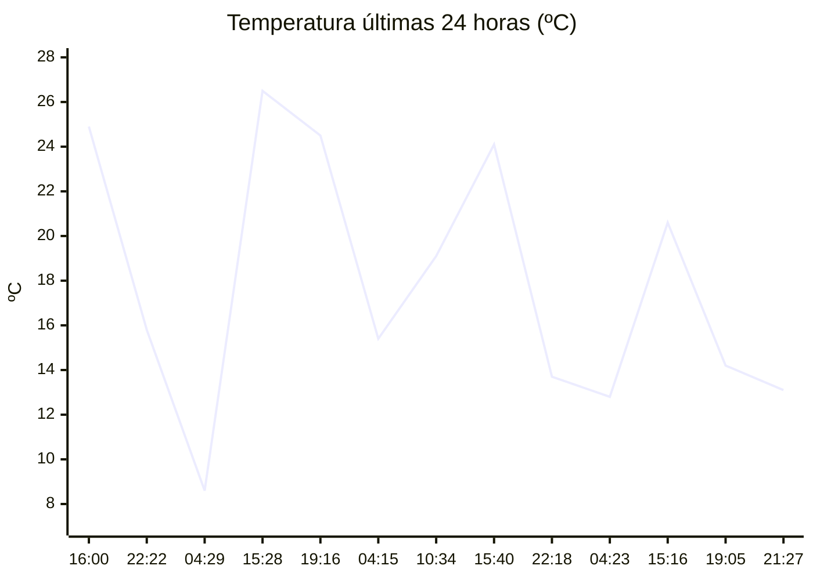

# rem-scrap

Actualización automática del clima para la estación Concarán.

## Últimos datos

| Campo | Valor |
| --- | --- |
| Estación | Concarán |
| Hora | 21:26 |
| Temperatura | 13,1 ºC |
| Humedad | 83,7 % |
| Lluvia (1h) | 0,0 mm |
| Lluvia (24h) | 0,0 mm |
| Lluvia (30d) | 40,6 mm |
| Lluvia (Año) | 552,6 mm |
| Rad. Solar | 0,0 W/m2 |
| Temp Max Hoy | 22 ºC a las 15:52 |
| Temp Min Hoy | 12 ºC a las 06:21 |
| VPS (VPD) | 0.25 kPa (bajo) |

## Resumen IA

Concarán, 21:26, presenta una noche fresca y húmeda. La temperatura actual es 13,1 ºC, mientras que la máxima del día alcanzó 22 ºC a las 15:52 y la mínima 12 ºC a las 06:21, lo que genera un rango térmico de 10 ºC. El valor de 13,1 ºC está a solo 1,1 ºC de la mínima y a 8,9 ºC de la máxima, por lo que se sitúa mucho más cerca del extremo frío del día. La humedad relativa es 83,7 % y el VPD (vps) registra 0,25 kPa, un déficit muy bajo; el aire está poco demandante, lo que favorece una transpiración reducida pero incrementa el riesgo de desarrollo de hongos por la humedad estancada. No se registró lluvia en la última hora ni en las últimas 24 h, aunque el acumulado del mes es 40,6 mm y del año 552,6 mm; la ausencia de precipitación reciente mantiene la humedad del suelo estable. La radiación solar es 0 W/m2, correspondiente a la hora nocturna. Recomendación: ventilar ligeramente el cultivo para disminuir la humedad del aire y prevenir problemas fúngicos.

## Tendencia últimas 24 h

## Fuente

Datos extraídos de [clima.sanluis.gob.ar](https://clima.sanluis.gob.ar/Estacion.aspx?estacion=8).

## Generado automáticamente

Este archivo fue actualizado el 24 de octubre de 2026 a las 12:27:53.
