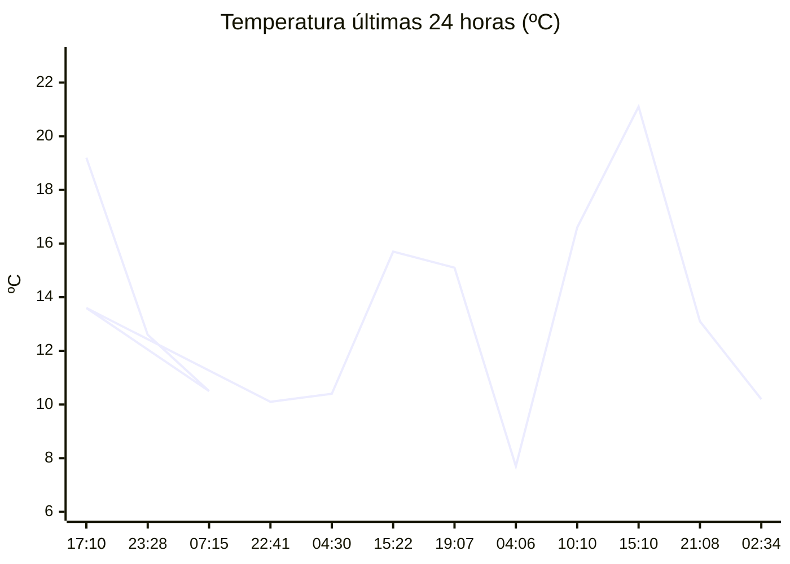

# rem-scrap

Actualización automática del clima para la estación Concarán.

## Últimos datos

| Campo | Valor |
| --- | --- |
| Estación | Concarán |
| Hora | 02:33 |
| Temperatura | 10,2 ºC |
| Humedad | 92,5 % |
| Lluvia (1h) | 0,0 mm |
| Lluvia (24h) | 0,0 mm |
| Lluvia (30d) | 28,5 mm |
| Lluvia (Año) | 540,5 mm |
| Rad. Solar | 0,0 W/m2 |
| Temp Max Hoy | 12 ºC a las 01:13 |
| Temp Min Hoy | 10 ºC a las 01:47 |
| VPS (VPD) | 0.09 kPa (bajo) |

## Resumen IA

Estación Concarán, 02:33 – madrugada fresca y muy húmeda.  

Temperatura actual 10,2 ºC se sitúa justo por encima de la mínima del día (10 ºC a 01:47) y bastante bajo de la máxima (12 ºC a 01:13); el rango térmico del día es de 2 ºC y la medida actual está a 0,2 ºC de la mínima y a 1,8 ºC de la máxima, acercándose más al extremo frío.  

La humedad relativa es 92,5 % y el VPD es 0,09 kPa, valor muy bajo (<0,8 kPa). El aire está poco demandante, la transpiración de las plantas será mínima y la humedad estancada favorece la aparición de hongos si no se ventila.  

No se registró lluvia en la última hora ni en las últimas 24 h; la precipitación acumulada en los últimos 30 d es 28,5 mm, lo que indica suelo todavía con humedad residual. La radiación solar es 0 W/m2, coherente con la hora nocturna.  

Recomendación: mantenga una ventilación ligera para reducir la humedad del aire y prevenir enfermedades foliares.

## Tendencia últimas 24 h

## Fuente

Datos extraídos de [clima.sanluis.gob.ar](https://clima.sanluis.gob.ar/Estacion.aspx?estacion=8).

## Generado automáticamente

Este archivo fue actualizado el 16 de octubre de 2026 a las 05:34:46.
