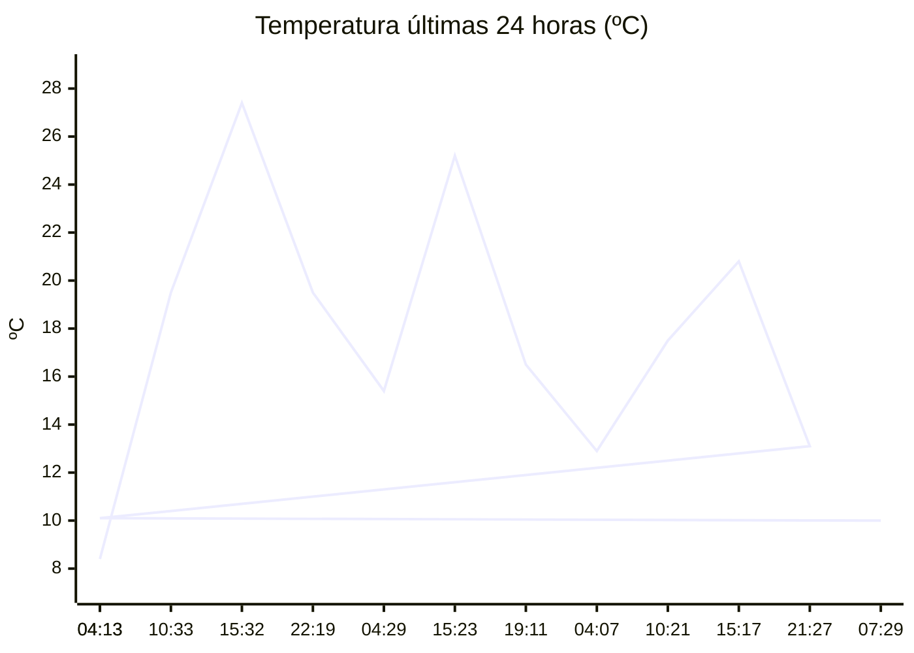

# rem-scrap

Actualización automática del clima para la estación Concarán.

## Últimos datos

| Campo | Valor |
| --- | --- |
| Estación | Concarán |
| Hora | 07:28 |
| Temperatura | 10,0 ºC |
| Humedad | 99,8 % |
| Lluvia (1h) | 0,1 mm |
| Lluvia (24h) | 2,1 mm |
| Lluvia (30d) | 42,8 mm |
| Lluvia (Año) | 554,8 mm |
| Rad. Solar | 56,0 W/m2 |
| Temp Max Hoy | 12 ºC a las 00:01 |
| Temp Min Hoy | 9 ºC a las 06:14 |
| VPS (VPD) | 0 kPa (bajo) |

## Resumen IA

Estación Concarán, 07:28 – mañana fresca y muy húmeda, con ligera llovizna persistente.  

Temperatura: la lectura actual es de 10,0 ºC, dentro del rango del día (9 ºC – 12 ºC). El rango térmico es de 3 ºC; la temperatura actual está a 1 ºC del mínimo registrado y a 2 ºC del máximo, por lo que se acerca más al extremo bajo del día.  

Humedad y vapor: la humedad relativa es de 99,8 %, casi saturada, y el VPD es 0 kPa, indicando ausencia de déficit de vapor. El aire está muy demandante para la transpiración, lo que reduce la necesidad de riego pero favorece la proliferación de hongos y enfermedades fúngicas en los cultivos.  

Lluvia y radiación: se registraron 0,1 mm en la última hora y 2,1 mm en las últimas 24 h, manteniendo el suelo húmedo. La radiación solar de 56 W/m2 a esta hora es baja, típica de la mañana, por lo que la energía solar disponible es limitada.  

Recomendación: evite riegos adicionales y favorezca la ventilación del cultivo para disminuir el riesgo de enfermedades por exceso de humedad.

## Tendencia últimas 24 h

## Fuente

Datos extraídos de [clima.sanluis.gob.ar](https://clima.sanluis.gob.ar/Estacion.aspx?estacion=8).

## Generado automáticamente

Este archivo fue actualizado el 24 de octubre de 2026 a las 10:29:27.
