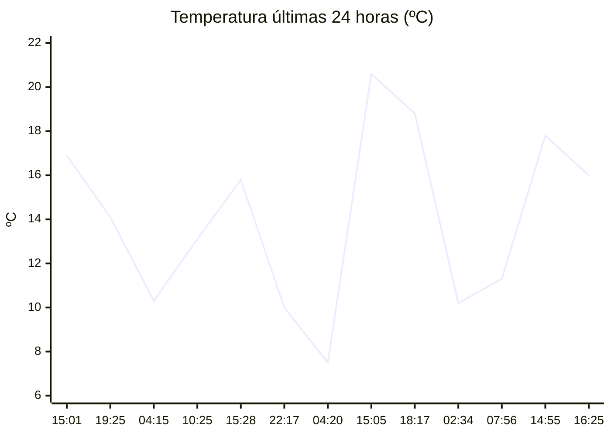

# rem-scrap

Actualización automática del clima para la estación Concarán.

## Últimos datos

| Campo | Valor |
| --- | --- |
| Estación | Concarán |
| Hora | 16:24 |
| Temperatura | 16,0 ºC |
| Humedad | 81,4 % |
| Lluvia (1h) | 2,9 mm |
| Lluvia (24h) | 7,6 mm |
| Lluvia (30d) | 36,0 mm |
| Lluvia (Año) | 548,1 mm |
| Rad. Solar | 339,0 W/m2 |
| Temp Max Hoy | 20 ºC a las 14:28 |
| Temp Min Hoy | 9 ºC a las 06:20 |
| VPS (VPD) | 0.34 kPa (bajo) |

## Resumen IA

Concarán, 16:24 – la tarde se muestra fresca y húmeda, con cielo parcialmente nublado pero con buen nivel solar.  

Temperatura actual 16,0 ºC está a 4 ºC por debajo de la máxima de 20 ºC y a 7 ºC por encima de la mínima de 9 ºC, por lo que se aproxima más al extremo máximo; el rango térmico del día es de 11 ºC.  

La humedad relativa es alta (81,4 %) y el VPD de 0,34 kPa está muy por debajo del umbral de 0,8 kPa, lo que indica aire poco demandante de agua, favoreciendo la retención de humedad y aumentando el riesgo de enfermedades fúngicas en cultivos.  

Lluvia reciente de 2,9 mm en la última hora y 7,6 mm en 24 h incrementan la humedad del suelo y del aire; la radiación solar de 339 W/m² a esta hora del día señala una irradiación moderada‑alta, suficiente para la fotosíntesis pero sin sequedad.  

Recomendación: ventilar los cultivos para reducir la humedad foliar y aplicar riego solo si el suelo está seco, evitando exceso que favorezca hongos.

## Tendencia últimas 24 h

## Fuente

Datos extraídos de [clima.sanluis.gob.ar](https://clima.sanluis.gob.ar/Estacion.aspx?estacion=8).

## Generado automáticamente

Este archivo fue actualizado el 16 de octubre de 2026 a las 07:25:19.
