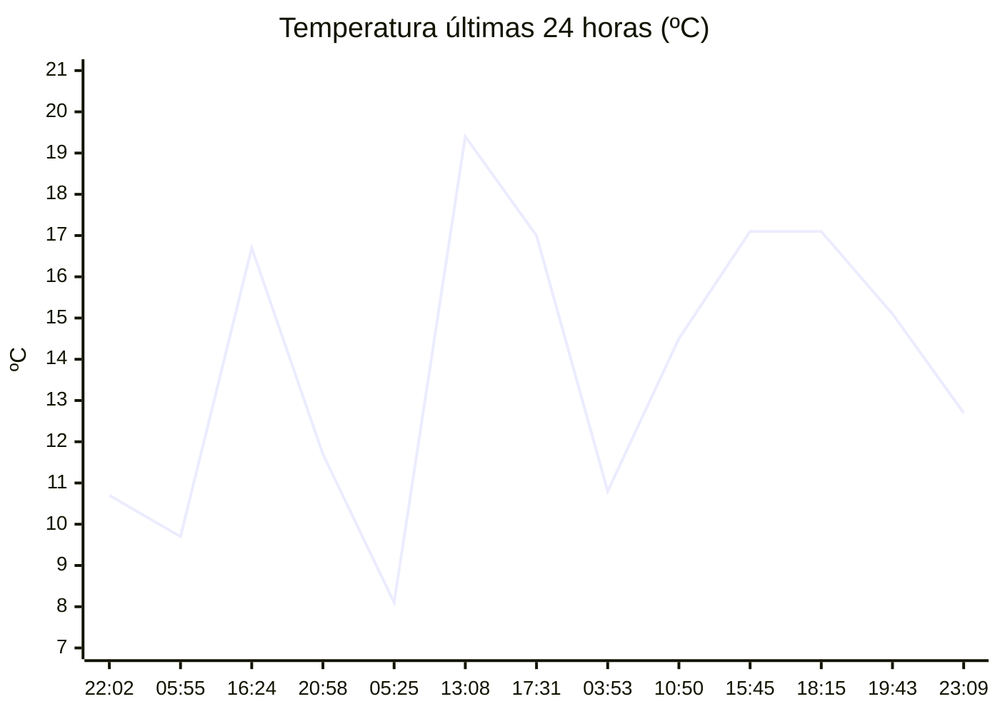

# rem-scrap

Actualización automática del clima para la estación Concarán.

## Últimos datos

| Campo | Valor |
| --- | --- |
| Estación | Concarán |
| Hora | 23:08 |
| Temperatura | 12,7 ºC |
| Humedad | 99,8 % |
| Lluvia (1h) | 0,0 mm |
| Lluvia (24h) | 0,1 mm |
| Lluvia (30d) | 36,9 mm |
| Lluvia (Año) | 534,3 mm |
| Rad. Solar | 0,0 W/m2 |
| Temp Max Hoy | 18 ºC a las 16:52 |
| Temp Min Hoy | 10 ºC a las 07:01 |
| VPS (VPD) | 0 kPa (bajo) |

## Resumen IA

Estación Concarán, 23:08 h – noche fresca y extremadamente húmeda.  
Temperatura actual 12,7 ºC, dentro del rango del día (10 ºC‑18 ºC) con un rango térmico de 8 ºC; está a 2,7 ºC del mínimo y a 5,3 ºC del máximo, por lo que se aproxima más al extremo frío del día.  
Humedad relativa 99,8 % y VPD 0 kPa indican aire casi saturado. Con VPD por debajo de 0,8 kPa el aire tiene mínima demanda de transpiración, lo que reduce la evaporación pero favorece la proliferación de hongos y enfermedades fúngicas en cultivos y aumenta la sensación de bochorno para personas.  
Lluvia en la última hora 0,0 mm y en las últimas 24 h 0,1 mm, suficiente para mantener la humedad del suelo y del aire; radiación solar 0 W/m2, típica de la hora nocturna.  
Recomendación: ventilar los invernaderos o cobertizos durante la madrugada y limitar el riego nocturno para evitar exceso de humedad que favorezca patógenos.

## Tendencia últimas 24 h

## Fuente

Datos extraídos de [clima.sanluis.gob.ar](https://clima.sanluis.gob.ar/Estacion.aspx?estacion=8).

## Generado automáticamente

Este archivo fue actualizado el 12 de octubre de 2026 a las 02:09:22.
