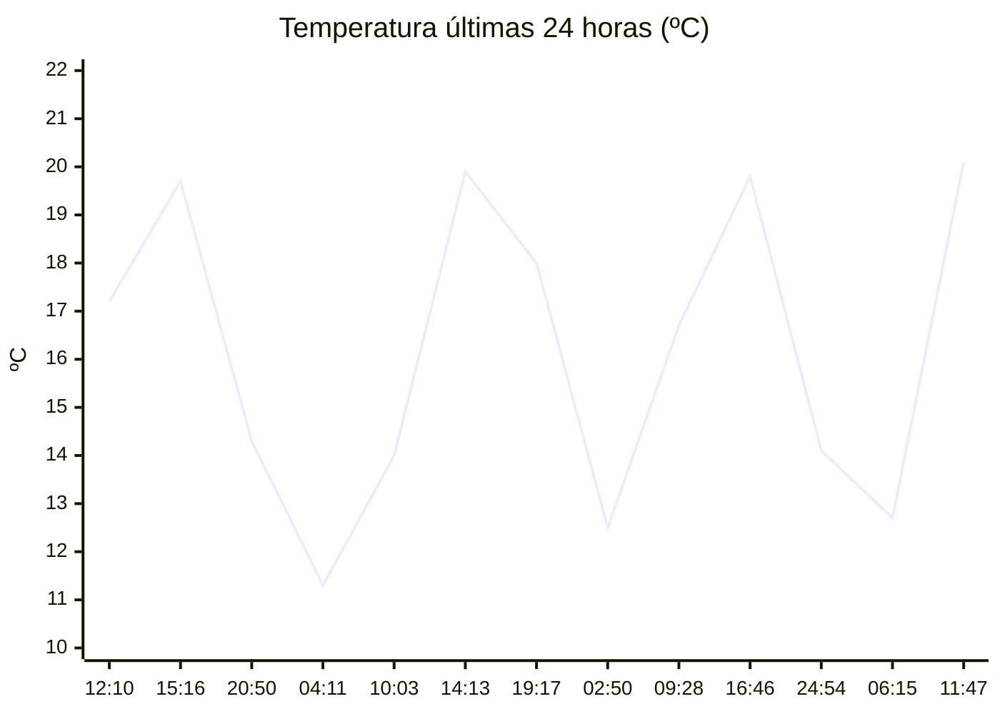

# rem-scrap

Actualización automática del clima para la estación Concarán.

## Últimos datos

| Campo | Valor |
| --- | --- |
| Estación | Concarán |
| Hora | 11:45 |
| Temperatura | 20,1 ºC |
| Humedad | 43,1 % |
| Lluvia (1h) | 0,0 mm |
| Lluvia (24h) | 0,0 mm |
| Lluvia (30d) | 36,0 mm |
| Lluvia (Año) | 548,1 mm |
| Rad. Solar | 423,0 W/m2 |
| Temp Max Hoy | 19 ºC a las 10:55 |
| Temp Min Hoy | 12 ºC a las 03:35 |
| VPS (VPD) | 1.34 kPa (alto) |

## Resumen IA

Concarán, 11:45 h – el ambiente se presenta templado y soleado.  
Temperatura actual 20,1 ºC supera la máxima registrada hoy (19 ºC a las 10:55) y está a 8,1 ºC del mínimo (12 ºC a las 03:35). El rango térmico del día es de 7 ºC; la temperatura del momento se ubica muy próximo al extremo máximo, incluso lo supera ligeramente.  
Humedad relativa 43,1 % junto a un VPD de 1,34 kPa indica aire relativamente seco y una demanda de transpiración algo alta; no es crítico, pero sí sugiere que las plantas pueden experimentar estrés hídrico moderado si no se les provee suficiente agua.  
No hubo lluvia en la última hora ni en las últimas 24 h, por lo que la humedad del suelo no se ha reforzado. La radiación solar de 423 W/m2 a media mañana es bastante intensa, lo que potencia la evaporación y el calentamiento del follaje.  
Recomendación: mantenga riegos parciales y, si es posible, brinde sombra ligera o ventilación para mitigar el estrés por déficit hídrico.

## Tendencia últimas 24 h

## Fuente

Datos extraídos de [clima.sanluis.gob.ar](https://clima.sanluis.gob.ar/Estacion.aspx?estacion=8).

## Generado automáticamente

Este archivo fue actualizado el 20 de octubre de 2026 a las 02:47:08.
