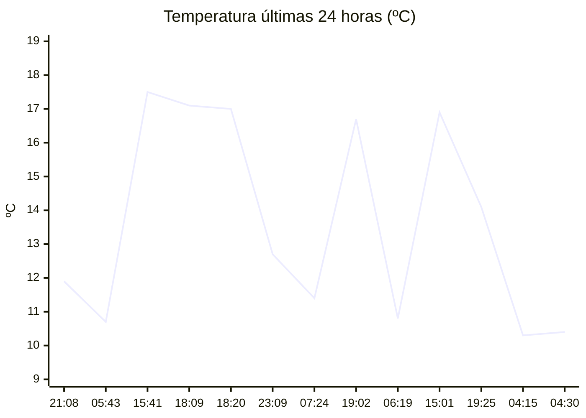

# rem-scrap

Actualización automática del clima para la estación Concarán.

## Últimos datos

| Campo | Valor |
| --- | --- |
| Estación | Concarán |
| Hora | 04:29 |
| Temperatura | 10,4 ºC |
| Humedad | 99,8 % |
| Lluvia (1h) | 0,1 mm |
| Lluvia (24h) | 1,0 mm |
| Lluvia (30d) | 26,7 mm |
| Lluvia (Año) | 538,6 mm |
| Rad. Solar | 0,0 W/m2 |
| Temp Max Hoy | 11 ºC a las 03:31 |
| Temp Min Hoy | 9 ºC a las 01:15 |
| VPS (VPD) | 0 kPa (bajo) |

## Resumen IA

Estación Concarán, 04:29 – madrugada fresca y extremadamente húmeda, con ligera llovizna.  
Temperatura: la lectura actual es 10,4 ºC, dentro del rango del día (9 ºC – 11 ºC). El rango térmico es de 2 ºC; la temperatura del momento está a 0,6 ºC del máximo y a 1,4 ºC de la mínima, por lo que se aproxima más al extremo máximo.  
Humedad y vapor: la humedad relativa es 99,8 % y el VPD (vps) registra 0 kPa, valor muy bajo que indica aire prácticamente saturado. La transpiración de las plantas será mínima y el ambiente propicia riesgos de hongos y enfermedades por humedad estancada.  
Lluvia y radiación: en la última hora cayó 0,1 mm y en las últimas 24 h acumuló 1,0 mm, lo que refuerza la humedad del aire. La radiación solar es 0 W/m2, típica de la madrugada sin aporte solar.  
Recomendación: ventilar el cultivo o aplicar medidas antifúngicas y posponer riegos hasta que disminuya la humedad.

## Tendencia últimas 24 h

## Fuente

Datos extraídos de [clima.sanluis.gob.ar](https://clima.sanluis.gob.ar/Estacion.aspx?estacion=8).

## Generado automáticamente

Este archivo fue actualizado el 14 de octubre de 2026 a las 07:30:51.
